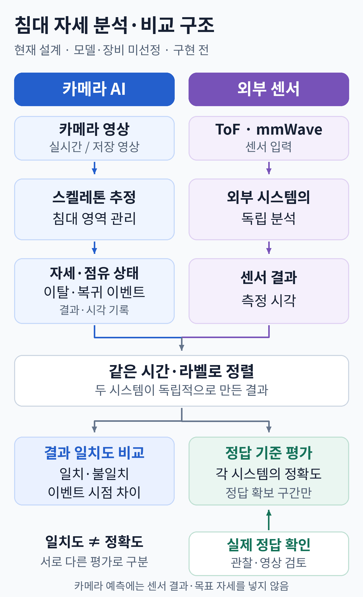

# 카메라 기반 침대 자세·움직임 분석 AI

카메라 영상에서 스켈레톤과 자세·이탈·복귀를 분석하고, 외부 ToF·mmWave 시스템의 독립 측정 결과와 같은 시간대에 비교하는 프로젝트입니다.

> **현재 단계 · 2026-10-27**
>
> 기획·설계 초안과 문헌 37편의 색인을 정리했고, **스켈레톤 후보 비교 실험 계획서**를 작성했습니다. P11·P12·P19·P34는 **본문 미확인(사실 판단 제외)**, P35의 2022 ACM 최종판도 **본문 미확인(해당 판본 판단 제외)**입니다. 모델·장비는 미선정입니다. **저장 영상 입력·정식 결과 기록·테스트용 어댑터를 연결**했고 개발 검사 29개를 통과했습니다. 실제 AI 모델 연결·학습·침대 영상 성능 실험은 시작 전입니다.

## 전체 구조 한눈에 보기



카메라 분석과 외부 센서 분석은 독립적으로 진행합니다. 두 결과의 **일치도 비교**와 실제 정답에 대한 **정확도 평가**를 구분합니다.

[그림 크게 보기](docs/assets/system-overview.png) · [상세 시스템 구조](docs/ARCHITECTURE.md)

## 현재까지 정리한 것

| 항목 | 상태 |
|---|---|
| 목적·기능·측정 흐름 | 초기 3자세·움직임 범위·촬영 운영 조건 합의, 판정 흐름 초안 작성 |
| 참고 논문 | 37편: 침대 자세 24편 + 스켈레톤 기술 13편 |
| 문헌 검증 상태 | 33편 관련 본문 대조(해당 판본 기준), **4편 본문 미확인·판단 제외** |
| 기술 후보 | 비교 기준·적용 방법 및 재현 가능한 실험 계획 작성, **실제 비교 전** |
| 다음 우선 과제 | 실제 모델 어댑터 하나 연결·검증, 외부 사양·촬영 조건 확인과 비교 영상·정답 확보 |

**논문 근거 사용 원칙:** 본문 미확인 논문의 초록·검색 요약에 있는 방법·효과·성능은 사실 판단과 모델·기술 선정에 사용하지 않습니다. P35처럼 특정 공개판만 확인한 경우에는 그 판본의 근거만 사용합니다. [상세 검증 규칙](docs/LITERATURE_REVIEW.md#본문-확인-여부에-따른-근거-채택-규칙)을 따릅니다. 문헌 보고 성능과 자체 실험 결과를 구분하며, **자체 성능 결과는 아직 없습니다.**

## 개발 방향

- 초기 자세는 **바로 누움·옆으로 누움·걸터앉음** 세 가지입니다. 움직임은 자세 변화와 이탈·복귀를 다룹니다. 이탈 완료는 침대에서 내려와 완전히 서 있는 시점입니다.
- 침대·카메라 배치는 세션마다 달라질 수 있지만 세션 중 카메라는 고정합니다. 다른 사람이 화면에 들어올 가능성을 고려합니다.
- 세부 판정 흐름은 설계 제안 단계이며, 복귀 운영 해석·외부 라벨 매핑·남은 조건은 [결정 사항](docs/DECISIONS.md)을 따릅니다.
- 관절 추정, 자세 분류, 침대 점유 상태, 이탈·복귀 이벤트를 구분합니다.
- 카메라 AI는 외부 센서 결과나 목표 자세를 예측 입력으로 사용하지 않습니다.
- 두 시스템의 일치도와 실제 정답 기준 정확도는 별도로 평가합니다. 최종 비교 범위는 협의 전입니다.
- **AI 추론의 실행 위치·방식은 미정입니다.** 기술 후보는 실제 인식 품질로 비교하며, 효율적인 코드 구현과 지연 관리는 개발 과정에서 독립적으로 고려합니다.

## 현재 실행 가능한 범위

Python **3.11 이상**에서 저장 영상의 프레임·원본 PTS를 준비하고, 합성 `fake` 어댑터로 원본/공통 관절·프레임 상태·실패·쓰기 시간을 기록합니다. 출력은 터미널 요약과 JSON/JSONL 파일입니다. 실제 사람을 검출하거나 자세·이탈을 판단하는 모델, 카메라 화면·스켈레톤 영상 출력은 아직 연결하지 않았습니다.

의존성은 [pyproject.toml](pyproject.toml)에 선언했습니다. PyAV 18.1.0의 Python 요구 조건에 맞춰 공통 실행 환경의 최소 버전을 3.11로 조정했습니다. Linux/Python 3.12에서 설치·생성 영상 실행·검사를 수행했으며 Windows 실동작 검증은 아직 수행하지 않았습니다. 선택한 Python 환경과 같은 `python`으로 **프로젝트 루트 폴더**에서 실행합니다.

```sh
python -m pip install -e .
python -m bed_pose demo --output data/demo_01
```

`demo`는 사람이 없는 6프레임 가변 간격 영상을 생성해 합성 관절을 기록합니다. `execution_kind`는 `synthetic`이며 AI 성능 결과가 아닙니다. 이미 존재하는 출력 폴더는 덮어쓰지 않으므로 재실행할 때 `demo_02`처럼 새 이름을 사용합니다.

출력 예의 핵심은 `run_status: succeeded`, `ledger_complete: true`, `counts: {ok: 6, failed: 0, not_processed: 0}`입니다. `run_directory`에 실제 결과 폴더가 표시됩니다. 결과 무결성 검사는 그 경로를 사용합니다.

```sh
python -m bed_pose inspect --run data/demo_01/runs/<출력된_run_id>
```

### 자신의 저장 영상으로 입력·기록 확인

다음 `videos/example.mp4`는 사용자가 가진 파일 경로로 바꿉니다. `prepare`는 영상/프레임/픽셀 SHA-256, 원본 정수 PTS·time base, 디코더 설정을 고정하고 실제 해시가 있는 `run_config.fake.json`을 생성합니다.

```sh
python -m bed_pose prepare --video videos/example.mp4 --output data/input_01
python -m bed_pose run --config data/input_01/run_config.fake.json
```

이 경우에도 관절은 영상에서 추론한 값이 아니라 합성 값입니다. 후보를 임의로 측정 대상에 연결하지 않으며 대상 상태는 `not_configured`입니다. 지원하는 모드·파일 읽기와 기록 경로를 확인하는 용도로 사용합니다. 입력 파일·프레임 목록·픽셀·디코더 환경이 준비할 때와 다르면 실행을 거부하거나 실패로 기록합니다. 비정상 display matrix·비정사각 픽셀·도중 영상 크기 변경은 지원하지 않습니다. 순수 90도 단위 회전은 적용하며 원본 시각을 FPS로 대체하지 않습니다.

### 의도적인 오류·미검출 확인

```sh
python -m bed_pose run --config data/input_01/run_config.fake.json --fake-no-detection-at 1 --fake-fail-at 2
```

프레임 번호는 0부터이며 입력 범위를 넘어가면 설정 오류입니다. 프레임 1은 후보 0명인 **정상 호출**, 프레임 2는 **추론 실패**, 이후는 **미처리**로 기록합니다. `--fake-people 2`는 두 합성 후보를, `--fake-missing-joint 3`은 특정 관절 누락을 시험합니다. 테스트 옵션은 매니페스트와 어댑터 profile에 기록합니다. 실패 실행의 종료 코드는 3이며 정상 테스트 사례로 실행해도 쉘에서는 비정상 종료로 보입니다.

### 결과와 검사

실행 폴더에는 `manifest.json`, 입력 스냅샷, `frame_results.jsonl`, `raw_results.jsonl`, `keypoints.jsonl`, `write_timings.jsonl`, `failure_cases.csv`가 생성됩니다. 실행 성공 여부와 기록 완결성은 별개입니다. `failed`이고 `ledger_complete: true`일 수 있으며 저장·검증에 실패하면 완료 상태를 보장하지 않습니다.

```sh
python -m unittest discover -s tests -v
```

검사 29개는 생성 영상·합성 어댑터로 PTS·회전·좌표·누락·오류·원본 보존·저장 실패·변조 감지 등을 확인합니다. 실제 침대 영상 정확도·실시간 지연·모델 우열을 검증한 것은 아닙니다. 첫 기록 프로토타입 `FrameLedger`는 호환용으로 남아 있고, CLI는 정식 스키마와 연결한 `ResultRecorder`를 사용합니다.

## 문서 찾아보기

처음에는 **진행 현황 → 결정 사항 → 이번 작업의 상세 문서** 순서로 읽습니다. 후보 비교를 준비할 때는 **기술 후보 비교 → 연산·실행 부담 비교 → 비교 실험 계획 → 관련 논문**으로 이어집니다.

### 현재 상태와 계획

| 문서 | 확인할 내용 |
|---|---|
| [진행 현황](docs/PROJECT_STATUS.md) | 완료한 작업, 미착수 작업, 다음 할 일 |
| [개발 로드맵](ROADMAP.md) | 단계별 작업과 완료 기준 |
| [확정·잠정·보류 사항](docs/DECISIONS.md) | 합의된 방향과 아직 결정하지 않은 항목 |

### 설계와 실험

| 문서 | 확인할 내용 |
|---|---|
| [기능 요구사항](docs/REQUIREMENTS.md) | 핵심 기능, 운영 기능, 추가 검토 기능 |
| [시스템 구조](docs/ARCHITECTURE.md) | 입력·분석·기록·비교의 역할과 데이터 흐름 |
| [초기 코드 구성 설계](docs/CODE_DESIGN.md) | 첫 비교 러너의 패키지·입출력·실패 처리·검사·확장 지점 제안 |
| [첫 비교 프로그램 세부 설계](docs/BENCHMARK_DETAIL_SPEC.md) | 필드·함수·상태·계측·쓰기·평가 계산 규약, draft 스키마와 가상 예시 |
| [측정 절차](docs/MEASUREMENT_PROTOCOL.md) | 자유·단일·순차 측정과 실제 정답 확인 |
| [데이터·평가 기준](docs/DATA_AND_VALIDATION.md) | 저장 항목, 시간 정렬, 분할, 지표 |
| [스켈레톤 비교 실험 계획](docs/POSE_BENCHMARK_PLAN.md) | 실제 실행 전 공통 프레임·관절·GT·지연 측정·기록 방식 |

### 논문과 기술 선택

| 문서 | 확인할 내용 |
|---|---|
| [기술 후보 비교](docs/TECHNOLOGY_CANDIDATES.md) | 후보별 장단점·구현 방법·선택 조건 |
| [기술별 연산·실행 부담 비교](docs/POSE_COMPUTE_AND_RESOURCE_COMPARISON.md) | 모델 구성·공개 처리 시간·학습 부담·결합 방식의 중립적 비교 |
| [논문 안내](docs/LITERATURE_REVIEW.md) | 읽는 순서, 확인 상태, 전체 색인 |
| [침대 위 자세 구분 논문 · 24편](docs/BED_POSTURE_PAPERS.md) | 침대 자세·이탈·가림·데이터셋 연구 |
| [스켈레톤 인식 기술 논문 · 13편](docs/SKELETON_TECHNOLOGY_PAPERS.md) | 관절 추정·프레임워크·후속 행동 분석 |

### AI에게 작업 맡기기

| 문서 | 확인할 내용 |
|---|---|
| [AI 공통 작업 지침](AGENTS.md) | AI가 먼저 읽을 프로젝트 맥락·범위·검증 원칙 |
| [복사해서 쓰는 작업 프롬프트](docs/AI_TASK_PROMPT.md) | 간단 요청문, 상세 양식, 설계·구현·논문 검증 예시 |

Codex 등 AI에게는 **공통 지침을 읽도록 요청한 뒤, 이번 작업과 완료 기준을 전달**하면 됩니다.

문서를 갱신할 때는 **진행 상태는 진행 현황**, **합의·미정 사항은 결정 사항**, **단계별 작업은 로드맵**에 기록합니다. 논문별 근거와 확인 범위는 해당 상세 항목에서 관리하고, 안내 문서는 그 항목을 연결합니다.

실험 영상·개인정보·학습 데이터는 이 저장소에 올리지 않습니다.

