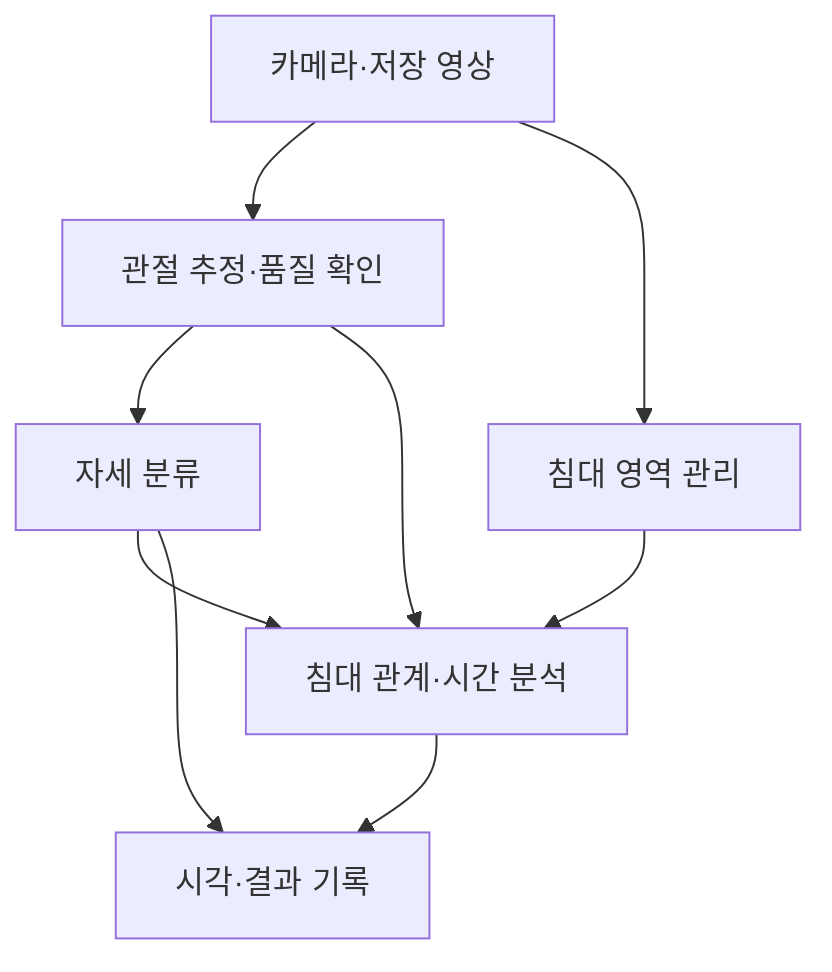
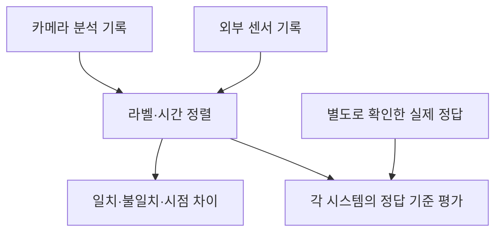

# 시스템 구조

[프로젝트 홈](../README.md) · [기능 요구사항](REQUIREMENTS.md) · [데이터·평가 기준](DATA_AND_VALIDATION.md)

**기준일: 2026-10-27 · 기능과 책임을 나눈 설계 초안**

현재 구현은 Python, PyAV/OpenCV, MediaPipe 실험용 어댑터, 로컬 HTTP 서버와 HTML 작업실을 사용합니다. 아래 흐름은 최종 목표를 포함한 기능 간 관계입니다. 현재 모듈과 지원 범위는 [진행 현황](PROJECT_STATUS.md)·[실행 안내](LIVE_MEASUREMENT.md)를 따릅니다. 모델의 최종 선정·실제 정확도 검증은 남아 있습니다.

첫 저장 영상 비교 러너의 Python 패키지·모듈 계약·기록·오류 처리 제안은 [초기 코드 구성 설계](CODE_DESIGN.md)에 정리했습니다. 실행 코드·모델 채택·최종 플랫폼 결정과 구분합니다.

그중 구현용 필드·함수·기록 상태·평가 공식은 [첫 러너 세부 설계](BENCHMARK_DETAIL_SPEC.md)를 따릅니다. 첫 대상 정책은 후보 전체 보존·추론 대상 미지정이며 자동 추적·이벤트 분석으로 확장하기 전 단계입니다.

## 카메라 분석 흐름

침대 영역과 관절 추정은 실제 구현에서 병렬 또는 결합 처리할 수 있습니다. **자세, 점유 상태, 이탈·복귀 이벤트는 각각의 출력으로 관리**합니다.

## 외부 결과 비교

정답 기준 평가는 실제 정답이 확보된 구간에서 수행합니다. 센서와의 일치도는 정확도를 대신하지 않습니다.

## 모듈별 역할

| 모듈 | 책임 | 주요 출력 |
|---|---|---|
| 영상 입력 | 실시간 수집·저장 영상 재생 | 프레임, 원본 시각, 수신 시각, 실험 ID |
| 침대 영역 | 자동 인식·재인식·수동 보정 | 영역 좌표·버전·유효 상태 |
| 관절 어댑터 | 모델 실행과 공통 관절 변환 | 원본 좌표·매핑 좌표·신뢰도·결측 |
| 자세 분류 | 영상에서 얻은 특징으로 독립 판단 | 자세 라벨·불확실 결과 |
| 상태·이벤트 | 시간 변화와 침대 상대 위치 분석 | 점유, 변화, 이탈·복귀 시각 |
| 측정 제어 | 목표 계획·준비·시작·단계 관리 | 계획 라벨·조작 시각·측정 구간 |
| 기록 | 결과·설정·선택적 영상 연결 | 재처리·비교 가능한 세션 기록 |
| 센서 어댑터 | 협의된 외부 출력 수신·변환 | 센서 라벨·측정 시각·상태 |
| 비교·보고 | 공통 기준으로 결과 평가 | 일치도, 시점 차이, 정답 평가 |

**입력 경계:** 측정 제어의 목표 자세와 외부 센서 결과는 카메라 자세 분류·이벤트 예측에 전달하지 않습니다. 비교 단계에서만 함께 사용합니다.

## 관절과 좌표 관리

| 표현 | 사용하는 곳 | 함께 확인할 점 |
|---|---|---|
| 원본 영상 좌표 | 화면 표시·오류 검토·재처리 | 해상도, 카메라 배치 |
| 신체 기준 정규화 좌표·각도 | 자세 분류 | 정규화로 침대 위치 정보가 사라지는지 |
| 침대 상대 위치 | 가장자리·점유·이탈 판단 | 영역 오차, 원근, 가림 |

모델별 관절 순서·좌우·좌표 범위를 명시하고 원본과 변환 결과를 함께 보존합니다. 추정 3D와 센서 실측 거리를 구분하며, 결측·보간·평활화 결과가 원래 관측을 덮어쓰지 않도록 설계합니다.

## 실시간 처리와 실패 상태

- 저장 영상과 카메라가 같은 분석 경로를 사용하면 같은 입력으로 후보를 비교할 수 있습니다.
- 촬영·수신·추론·출력 시각을 구분합니다. 촬영 시각을 알 수 없다면 대체 시각의 의미를 기록합니다.
- 사람 미검출, 관절 불량, 침대 영역 불확실을 구분합니다. 미검출만으로 이탈을 확정하지 않습니다.
- 시간 모델의 입력 길이·미래 프레임 사용 여부·평활화 지연을 기록합니다. 전체 영상을 사용한 결과와 실시간 결과를 구분합니다.

## 판정 흐름 상세 제안 · 2026-10-27

아래는 대화에서 제안한 설계이며 정책·임계값 확정이나 구현 완료를 뜻하지 않습니다. 초기 범위와 복귀 해석의 근거는 [결정 사항](DECISIONS.md)을 따릅니다.

### 책임 분리

관절 어댑터 → 대상 선택·공통 좌표 변환 → 품질 검사 → 자세 안정화 및 침대 이벤트 판정으로 나눕니다. 대상 식별 불확실, 관절별 결측·품질, 침대 영역 유효성은 별도 출력으로 관리합니다. 대상 추적 방식은 미선정이며 다인 동시 측정 기능을 확정한 것이 아닙니다.

### 자세와 판정 상태

| 상태 제안 | 의미 | 처리 |
|---|---|---|
| 안정 | 유효한 관측에서 자세가 일관됨 | 바로 누움·옆으로 누움·걸터앉음 중 확인 결과 표시 |
| 변화 후보 | 다른 자세의 증거가 있으나 확정 전 | 후보를 관찰하고 원래 자세로 돌아오면 취소 |
| 판정 보류 | 필요한 관절·대상·침대 정보가 부족함 | 해당 출력만 보류; 마지막 확인 자세·시각과 현재 상태를 구분 |

변화 후보를 실제 동작 전환의 정답으로 취급하지 않습니다. 관측 공백은 안정 확인 시간에 더하지 않으며, 복구 시 현재 관측부터 재평가합니다. 세 자세 밖의 동작이나 서 있는 상태를 억지로 세 자세에 배정하지 않습니다. 서 있음은 이탈 조건에서 별도로 검사합니다.

### 이벤트와 보류

- 같은 대상이 내려와 완전히 서 있는 흐름을 확인하면 이탈 완료 후보를 검사합니다. 걸터앉거나 일어나다 다시 앉은 경우에는 이탈 완료를 기록하지 않습니다.
- 복귀는 다시 걸터앉는 운영 해석을 기준으로 검토하며, 바로 올라가 눕는 경로는 포함 제안입니다. 침대 밖 이전 상태·대상 연속성과 세부 완료 경계 확인이 필요합니다.
- 확인된 이벤트는 한 번 기록하며 같은 상태가 지속된다는 이유로 반복 생성하지 않습니다. 측정 시작 때 이미 침대 밖인 경우 초기 상태만 기록합니다.
- 대상 혼동은 대상 관련 판정을, 침대 영역 오류는 침대 관계가 필요한 판정을 보류합니다. 관절 일부 누락은 작업별 정보 충분성을 검사합니다. 가능한 분석과 원본·오류 기록은 계속합니다.
- 미검출은 이탈의 증거가 아닙니다. 관측 공백의 이벤트는 확인 없이 채우지 않습니다. 재등장만으로 동일 대상이라고 보장하지 않으며 복구·재선택 방법은 미정입니다.
- 완료 추정·판정 확정·결과 출력 시각을 분리합니다. 확인 대기로 인한 지연을 추정 완료 시각으로 숨기지 않습니다.

확인 시간, 기하학적 검사, 품질 임계값은 검증 자료에서 정합니다. 규칙 검사·시간 일관성은 정확도의 보증이 아니며, 학습 기반 품질 검사는 필요성과 정답 확보 후 검토합니다. 준비 시간/완료 버튼 우선순위, 일시정지 범위, 대기열·프레임 건너뜀·재연결·저장 실패 정책도 아직 미정입니다.

## 구현 순서와 미정 사항

1. 동일 영상에서 관절 추정 후보를 비교합니다.
2. 규칙/SVM/RF/MLP 등의 단순 자세 분류와 상태 전이 기준선을 구성합니다.
3. 실패 원인과 데이터량을 확인한 뒤 시간·그래프 모델을 비교합니다.

**추론 실행 방식은 아직 미정입니다.** 모델 어댑터를 분리하고 효율적인 코드와 실제 처리 지연 측정을 초기부터 고려합니다. 스마트폰 카메라 입력은 전송 지연을 포함해 별도 확인합니다. 후보별 구성은 [기술 후보 비교](TECHNOLOGY_CANDIDATES.md), 동일 영상 비교 방법은 [실험 계획](POSE_BENCHMARK_PLAN.md), 구현 단계는 [로드맵](../ROADMAP.md)에 정리했습니다.
