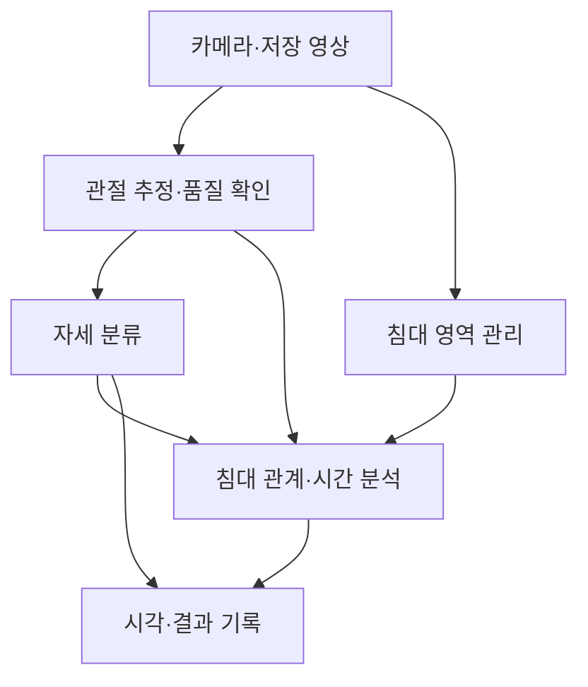
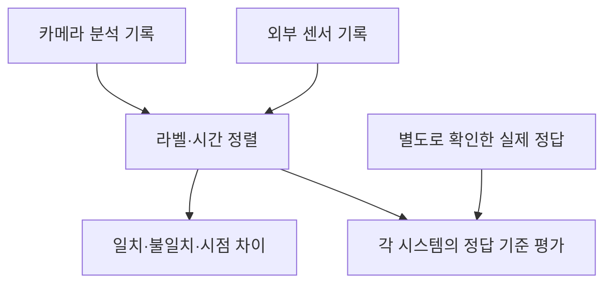

# 시스템 구조

[프로젝트 홈](../README.md) · [기능 요구사항](REQUIREMENTS.md) · [데이터·평가 기준](DATA_AND_VALIDATION.md)

**기준일: 2026-10-25 · 기능과 책임을 나눈 설계 초안**

언어·라이브러리·DB·서버·프로세스 구성은 아직 선정하지 않았습니다. 아래 흐름은 기능 간 관계를 나타냅니다.

## 카메라 분석 흐름

침대 영역과 관절 추정은 실제 구현에서 병렬 또는 결합 처리할 수 있습니다. **자세, 점유 상태, 이탈·복귀 이벤트는 각각의 출력으로 관리**합니다.

## 외부 결과 비교

정답 기준 평가는 실제 정답이 확보된 구간에서 수행합니다. 센서와의 일치도는 정확도를 대신하지 않습니다.

## 모듈별 역할

| 모듈 | 책임 | 주요 출력 |
|---|---|---|
| 영상 입력 | 실시간 수집·저장 영상 재생 | 프레임, 원본 시각, 수신 시각, 실험 ID |
| 침대 영역 | 자동 인식·재인식·수동 보정 | 영역 좌표·버전·유효 상태 |
| 관절 어댑터 | 모델 실행과 공통 관절 변환 | 원본 좌표·매핑 좌표·신뢰도·결측 |
| 자세 분류 | 영상에서 얻은 특징으로 독립 판단 | 자세 라벨·불확실 결과 |
| 상태·이벤트 | 시간 변화와 침대 상대 위치 분석 | 점유, 변화, 이탈·복귀 시각 |
| 측정 제어 | 목표 계획·준비·시작·단계 관리 | 계획 라벨·조작 시각·측정 구간 |
| 기록 | 결과·설정·선택적 영상 연결 | 재처리·비교 가능한 세션 기록 |
| 센서 어댑터 | 협의된 외부 출력 수신·변환 | 센서 라벨·측정 시각·상태 |
| 비교·보고 | 공통 기준으로 결과 평가 | 일치도, 시점 차이, 정답 평가 |

**입력 경계:** 측정 제어의 목표 자세와 외부 센서 결과는 카메라 자세 분류·이벤트 예측에 전달하지 않습니다. 비교 단계에서만 함께 사용합니다.

## 관절과 좌표 관리

| 표현 | 사용하는 곳 | 함께 확인할 점 |
|---|---|---|
| 원본 영상 좌표 | 화면 표시·오류 검토·재처리 | 해상도, 카메라 배치 |
| 신체 기준 정규화 좌표·각도 | 자세 분류 | 정규화로 침대 위치 정보가 사라지는지 |
| 침대 상대 위치 | 가장자리·점유·이탈 판단 | 영역 오차, 원근, 가림 |

모델별 관절 순서·좌우·좌표 범위를 명시하고 원본과 변환 결과를 함께 보존합니다. 추정 3D와 센서 실측 거리를 구분하며, 결측·보간·평활화 결과가 원래 관측을 덮어쓰지 않도록 설계합니다.

## 실시간 처리와 실패 상태

- 저장 영상과 카메라가 같은 분석 경로를 사용하면 같은 입력으로 후보를 비교할 수 있습니다.
- 촬영·수신·추론·출력 시각을 구분합니다. 촬영 시각을 알 수 없다면 대체 시각의 의미를 기록합니다.
- 사람 미검출, 관절 불량, 침대 영역 불확실을 구분합니다. 미검출만으로 이탈을 확정하지 않습니다.
- 시간 모델의 입력 길이·미래 프레임 사용 여부·평활화 지연을 기록합니다. 전체 영상을 사용한 결과와 실시간 결과를 구분합니다.

## 구현 순서와 미정 사항

1. 동일 영상에서 관절 추정 후보를 비교합니다.
2. 규칙/SVM/RF/MLP 등의 단순 자세 분류와 상태 전이 기준선을 구성합니다.
3. 실패 원인과 데이터량을 확인한 뒤 시간·그래프 모델을 비교합니다.

**2026-10-26 결정:** 실제 측정 시 카메라 AI 추론은 **로컬 PC**에서 실행하는 방향을 기본으로 합니다. 최종 운영 PC·OS·카메라는 미정이며, 현재 저사양 개발 장비를 기준으로 기술 후보를 제한하지 않습니다. 모델 어댑터를 분리해 실행 장치·OS 차이를 처리하고, 효율적인 코드와 실제 처리 지연 측정을 초기부터 고려합니다. 스마트폰 카메라 입력은 전송 지연을 포함해 별도 확인합니다. 후보별 구성은 [기술 후보 비교](TECHNOLOGY_CANDIDATES.md), 동일 영상 비교 방법은 [실험 계획](POSE_BENCHMARK_PLAN.md), 구현 단계는 [로드맵](../ROADMAP.md)에 정리했습니다.
