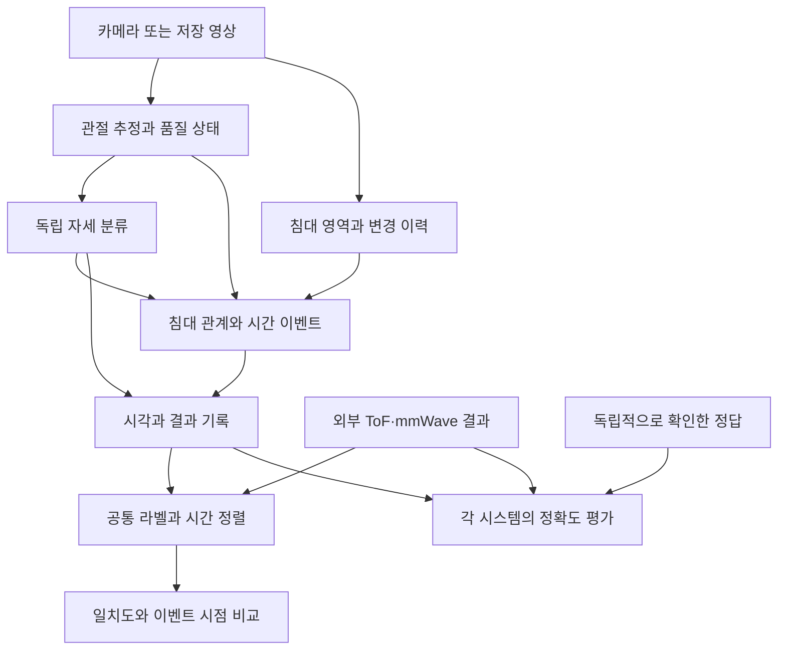

# 시스템 아키텍처 초안 (v0.3)

이 문서는 **기능 및 책임 분리**를 나타냅니다. 프로그램 개수, 프로세스, 언어·라이브러리, DB 및 서버 구조는 아직 확정하지 않았습니다.

## 기능적 흐름

침대 영역 파악과 스켈레톤 추정은 실제 구현에서는 병렬 또는 결합 처리할 수 있으며 위 그림은 개념적 순서를 나타냅니다.

## 논리적 책임 분리

| 책임 | 입력 | 출력/주요 고려 |
|---|---|---|
| 영상 수집·재생 | 실시간 카메라 또는 저장 영상 | 프레임, 원본 영상 시각, 수신/처리 시각, 실험 식별자 |
| 침대 영역 관리 | 영상, 사용자 보정 | 영역 및 변경 이력, 유효/불확실 상태 |
| 스켈레톤 추정 | 영상 | 원본 좌표·관절 정의·신뢰도/가시성·결측 마스크·추적 상태 |
| AI 자세 분류 | 카메라에서 얻은 특징 | 자세 후보/불확실 결과 |
| 상태·이벤트 분석 | 예측의 시간적 변화, 침대 상대 위치 | 점유/이탈/복귀 및 변화 시각 |
| 측정 제어 | 사전 시나리오, 준비·시작 입력 | 측정 구간/목표 자세; **AI 예측에는 전달하지 않음** |
| 기록 | 측정 결과, 이벤트, 선택적 영상 | 동기 비교와 오류 재검토용 데이터 |
| 외부 센서 어댑터 | 원시 측정 또는 분류된 센서 출력 | 비교 가능한 시간·라벨·상태 정보 |
| 비교/보고 | 두 독립 결과와 선택적 검증 정답 | 일치/불일치, 감지 시점 차이, 정확도 보완 지표 |

## 설계 핵심

1. **독립성:** 카메라 측 자세 예측은 사전 목표 자세와 센서의 예측을 입력으로 사용하지 않음.
2. **두 평가의 분리:** 센서-카메라 **일치도**가 주목적일 가능성이 높으며, 확인된 실제 정답이 있으면 **정확도**를 별도 평가.
3. **시각:** 촬영/센서 측정 시각과 도착·처리 시각이 다를 수 있으므로 구분할 수 있게 설계.
4. **이탈/미검출 분리:** 신체가 보이지 않으면 자동으로 침대 밖이라 단정하지 않고 판정 불가를 허용.
5. **변경 가능성:** 최종 분류 기준과 센서 출력 형식이 아직 미정이므로 공통 라벨 매핑·어댑터는 교체 가능한 경계로 둠.
6. **침대 배치:** 최초 자동 영역 인식과 수동 수정 기능은 최종 목표지만 초기 스켈레톤 실증은 단순 영역 지정으로 진행 가능.

## 미선정 기술

MediaPipe Pose, MoveNet, YOLO Pose, MMPose/RTMPose 등은 검토 후보일 뿐 선정된 제품/의존성이 아닙니다. 직접 학습하는 별도 자세 분류 AI의 구조도 미정입니다.

## 문헌 기반 처리 구조 제안

### 공통 입력과 품질 관리

저장 영상과 실시간 카메라가 같은 관절 추정·분류 경로를 사용하도록 설계하면 같은 영상으로 모델을 공정하게 비교할 수 있습니다. 스마트폰(Android/iPhone)을 카메라로 사용하는 경우 USB/Wi-Fi 연결과 전송 지연은 별도 실증 대상이며 연결 방식은 미정입니다. 현재 개발 OS 논의는 Windows 기준이고 CPU/GPU/RAM은 확인 전입니다.

관절 순서·좌우 정의·좌표 범위가 모델마다 다르므로 원본 출력과 공통 변환 결과를 함께 관리합니다. 모델이 추정한 깊이와 깊이 센서가 측정한 거리를 구분합니다. 결측값을 단순히 0 좌표로 해석하지 않으며, 보간·평활화 여부와 원래 신뢰도를 남깁니다.

### 세 종류의 공간 정보

| 표현 | 용도 | 주의점 |
|---|---|---|
| 원본 영상 좌표 | 오버레이·오류 재검토·재처리 | 해상도와 카메라 배치에 영향받음 |
| 신체 기준 정규화 좌표/각도 | 자세 분류, 체격·화면 크기 차이 완화 | 침대 안팎의 절대 이동 정보가 사라질 수 있음 |
| 침대 상대 위치 | 가장자리·점유·이탈 판단 | 침대 영역 오차·원근·가림의 영향을 별도로 평가 |

자세 분류, 침대 관계, 시간 이벤트는 분리된 출력으로 유지합니다. 세부 라벨과 이벤트 시작/완료 조건은 외부 센서 담당자와 협의해야 하며, 논문 라벨을 그대로 제품 사양으로 확정하지 않습니다.

### 모델 비교 순서

1. MediaPipe Pose·YOLO Pose·RTMPose로 관절 검출 가능성 비교. MoveNet은 후보 유지.
2. 관절 각도·상대 거리·몸통 방향 등의 특징과 규칙/SVM/RF/MLP 기준선 비교.
3. 연속 프레임과 침대 관계를 이용한 상태 전이 규칙 검증 후 LSTM/TCN 비교.
4. 필요 시 ST-GCN, 2s-AGCN, PoseC3D 및 가림 대응 모델 검토.

실시간 모델은 미래 프레임 사용 여부와 입력 윈도 길이를 명시합니다. 양방향 모델이나 전체 영상 평가 성능을 그대로 실시간 성능으로 해석하지 않습니다. 근거와 한계는 [논문 문서](LITERATURE_REVIEW.md)를 참조합니다.
