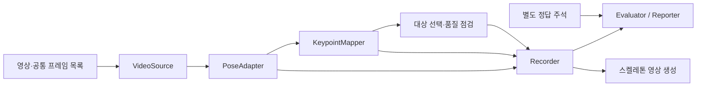

# 초기 코드 구성 설계

[프로젝트 홈](../README.md) · [시스템 구조](ARCHITECTURE.md) · [비교 실험 계획](POSE_BENCHMARK_PLAN.md) · [진행 현황](PROJECT_STATUS.md)

**작성: 2026-10-27 · 상태: 저장 영상·정식 기록·합성 어댑터 연결, MediaPipe 코드·SDK 경계 검사·사용자 PC 실행 보고, 정답 기반 평가 전**

> 기존 합의의 기준은 [결정 사항](DECISIONS.md)입니다. 이 문서는 첫 저장 영상 비교 러너의 패키지·입출력·오류 처리·검증 방법을 구체화합니다. 언어·라이브러리·스키마 선택은 구현 제안이며 최종 추론 플랫폼이나 모델 채택을 확정하지 않습니다.

첫 구현의 정확한 필드·함수·상태·시각·기록·평가 공식은 [세부 설계](BENCHMARK_DETAIL_SPEC.md)를 따릅니다. 초기 draft 스키마와 가상 예시를 포함하며 실행 코드·SDK 지원 완료와 구분합니다.

## 1. 첫 구현의 범위와 기술 제안

현재 실행 범위는 [README](../README.md)를 따릅니다. 첫 단계의 영상 입력은 PyAV 18.1.0·NumPy로 구현했고, FrameResult 스키마는 패키지 리소스로도 포함합니다. MediaPipe 어댑터를 연결하고 사용자 PC의 실행을 보고받았으며, 정답 기반 관절/침대 성능은 미검증입니다. 정답 없는 진단·비교와 SVG 프레임 오버레이를 구현했습니다. GT 기반 평가는 후속 단계입니다. 아래 전체 디렉터리의 모든 파일이 구현된 것은 아닙니다.

Python 패키지와 CLI로 시작하고, 저장 영상 한 개·모델 설정 한 개를 한 실행으로 처리합니다. 후보별 실행은 순차적으로 수행해 동시 자원 경쟁을 피합니다. 최종 자세 분류·이탈/복귀·실시간 운영은 후속 단계입니다. 스켈레톤 영상은 저장 결과를 읽는 후처리로 생성합니다.

| 항목 | 구현 제안 | 선택 이유·확인 조건 |
|---|---|---|
| 언어·공통 계약 | Python, `dataclasses`·`typing.Protocol` 등 표준 라이브러리 | 모델 SDK와 독립된 데이터·함수 경계, 작은 단위 검사 |
| 영상 입력 | 원본 PTS를 읽는 디코더 어댑터; PyAV를 우선 검토 | 가변 프레임 간격·시각 근거 보존. 실제 버전·코덱·회전 처리 지원은 구현 시 확인 |
| 영상 배열·그리기 | 배열 표현은 NumPy 제안, 오버레이는 OpenCV 등 별도 검토 | 프레임 색상·크기 계약을 공통화하고 렌더링 비용을 추론과 분리 |
| 설정·기록 | JSON 설정, JSON 매니페스트·JSONL 결과 | 기존 실험 계획과 연결하고 사람이 기록을 검사할 수 있게 함 |
| 의존성 관리 | 공통 부분과 모델별 설치 항목 분리 | 선택하지 않은 SDK를 import하지 않음. 충돌 시 후보별 가상환경과 동일 파일 계약 사용 |
| 검사 | pytest 제안 | 좌표·시각·실패·지표의 실제 오류를 찾는 사례 중심 검사 |

실제 패키지 버전·가중치·라이선스·장치 지원을 확인한 뒤 실행 환경을 고정합니다. 첫 어댑터는 기존 계획의 MediaPipe Pose Landmarker 후보로 연결할 수 있으나, 연결 순서는 인식 성능 순위가 아닙니다. 이후 YOLO Pose·RTMPose를 같은 계약에 연결합니다. MoveNet은 추가 대안입니다.

## 2. 제안 디렉터리

아래는 생성 예정 구조입니다. 전체 구조가 구현되었다는 뜻은 아닙니다. 현재 공통 기반 구현 범위는 [진행 현황](PROJECT_STATUS.md)을 따릅니다. 기능을 구현할 때 필요한 파일부터 만듭니다.

```text
bed-pose-skeleton-ai/
  pyproject.toml                 # 패키지·공통/선택 의존성·검사 설정
  configs/                      # 민감정보·실제 참가자 경로 없는 설정 예제
  src/bed_pose/
    __init__.py
    __main__.py                  # CLI 진입
    cli.py                      # 인자 해석·명령 연결
    contracts.py                # 프레임·모델 결과·기록 데이터형
    config.py                   # 설정 검사·실행 설정 확정
    video.py                    # 공통 프레임 목록 생성·순차 읽기
    runner.py                   # 실행 순서·생명주기·단계별 시간 측정
    pose/
      __init__.py
      base.py                   # PoseAdapter 계약
      mediapipe_adapter.py
      yolo_adapter.py
      rtmpose_adapter.py
    mapping.py                  # 모델 관절 정의·좌표계 → 공통 17점
    target.py                   # 최소 대상 선택·모호 상태, 후속 추적 확장
    quality.py                  # 결측·수치·점수·시간 연속성 점검
    recording.py                # 실행 상태·원본/공통 결과·오류 기록
    evaluation.py               # 기록+선택적 정답으로 지표 계산
    reporting.py                # 공통 조건 확인·후보별 비교표
    visualization.py            # 기록을 읽어 스켈레톤 영상 생성
  tests/
    test_mapping.py
    test_video_time.py
    test_target_quality.py
    test_recording_failures.py
    test_evaluation.py
    test_runner_integration.py
  data/                         # 실제 영상·주석·프레임 목록; Git 제외
  runs/                         # 실행 산출물; Git 제외
```

`runner.py`는 모듈을 연결하고 각 모듈은 자기 역할만 수행합니다. 모델 어댑터는 다른 어댑터를 호출하지 않습니다. `contracts.py`는 모델 SDK를 import하지 않습니다. 평가·보고·시각화는 추론 결과를 읽으며 모델을 다시 실행하지 않습니다. 첫 버전은 함수·작은 클래스를 직접 조합하고 범용 플러그인 로더·서버·DB를 추가하지 않습니다.

### 개발용 테스트와 실제 구동 중 품질 검사

`tests/`는 개발 중 관절 변환·시각 보존·실패 기록·평가 계산의 코드 오류를 검사하는 자동 테스트입니다. 개발자가 검사 명령으로 실행하며, 이후 도입하는 CI에서도 실행할 수 있습니다. 일반 분석 프로그램 시작이나 매 프레임 처리에 자동으로 포함하지 않습니다. pytest 등의 검사 도구는 개발용 의존성으로 분리합니다.

| 구분 | 실행 시점 | 역할 |
|---|---|---|
| `tests/` | 개발·수정 후, 검사를 실행할 때 | 미리 정한 입력과 기대 결과로 구현 오류 확인 |
| `quality.py` | 실제 영상 분석 중 | 관절 결측·비정상 수치·설정된 품질 규칙을 점검해 해당 프레임의 처리에 필요한 정보 제공 |

테스트 코드는 유지보수를 위해 저장소에 보관하는 안입니다. 사용자 배포 패키지에서는 제외할 수 있고 일반 실행의 의존성이 되지 않도록 구성합니다. 첫 버전에서 모든 테스트 파일을 미리 만들지 않고 실제 기능의 중요한 오류를 확인하는 사례부터 추가합니다. 테스트 통과와 실제 침대 영상의 인식 성능 검증은 별도 상태로 보고합니다.

## 3. 처리 흐름과 모듈 계약



| 구성 요소 | 입력 | 출력·책임 |
|---|---|---|
| `VideoSource` | 영상, 공통 프레임 목록·디코드 설정 | `FramePacket` 또는 식별 가능한 읽기 오류. RGB 순서·방향·크기를 일관되게 제공 |
| `PoseAdapter` | 영상 프레임·SDK용 시각, 모델 설정 | `PoseOutput`: SDK가 반환한 모든 인물 후보·원본 수치·메타데이터. 내부 검출기·전처리·추적 포함 |
| `KeypointMapper` | 원본 후보, 관절 매핑·영상 변환 정보 | 후보별 공통 COCO17 좌표. 원본 좌표를 덮어쓰지 않음 |
| `TargetResolver` | 공통 후보, 추론용 대상 지정·이전 상태 | `resolved / unresolved / ambiguous / not_configured`. 매칭 근거와 상태 변경 기록 |
| `QualityChecker` | 후보·공통 좌표·이전 관측·검증된 정책 | 관절별 수치/결측/점수·시간 불연속 보고. 원본 삭제나 정답 판정 금지 |
| `Recorder` | 프레임 상태, 원본·공통 결과, 대상·품질 보고, 시간 | 식별자·참조가 맞는 결과 기록과 실행 완료/실패 상태 |
| `Evaluator` | 완료 여부가 검증된 기록, 평가 설정·선택적 정답 | 지표별 값·분자/분모·미계산 사유·평가 범위 |
| `Reporter` | 여러 실행의 결과와 평가 조건 | 동일 조건 여부·비교 가능한 지표·실패 사례 표 |
| `OverlayRenderer` | 원본 영상과 기록 결과 | 프레임 식별자를 맞춘 스켈레톤 영상. 모호·누락·대상 상태 표시 |

모델마다 요구되는 검출기·크롭·리사이즈·RGB/BGR 변환은 어댑터 경계 안에서 처리합니다. 원본 픽셀 좌표로 되돌리는 변환 정보를 매퍼에 제공합니다. 공통 입력 해상도는 같게 하되 모델 내부 입력 크기는 모델별 권장 설정을 기록합니다.

어댑터의 공통 인터페이스는 다음 수준으로 제한하는 안입니다. 아래는 프로젝트 내부 계약을 설명하는 의사 코드이며 SDK API나 구현된 클래스가 아닙니다.

```python
class PoseAdapter(Protocol):
    def open(self, settings: PoseSettings) -> AdapterMetadata: ...
    def reset_for_video(self) -> None: ...
    def estimate(self, frame: ModelInput) -> PoseOutput: ...
    def close(self) -> None: ...
```

`open`에서 지원 기능·모델 메타데이터를 확인하고, `reset_for_video`로 영상 사이의 상태를 분리합니다. 종료·예외 경로에서도 `close`를 호출합니다. 순수 변환·평가 함수는 이 인터페이스를 상속하지 않고 데이터형을 입력으로 받습니다.

## 4. 핵심 데이터형 제안

아래 필드는 계약 초안입니다. 구현 시 단위·선택 필드·스키마 버전을 명시합니다.

| 데이터형 | 주요 필드 | 보장할 내용 |
|---|---|---|
| `FramePacket` | `video_id`, `frame_id`, RGB 이미지, `width`, `height`, `source_pts`, `time_base`, `timestamp_source` | 프레임 번호는 영상 내 표시 순서 식별자. PTS는 원본 정수와 유리수 time base를 보존 |
| `ModelInput` | `FramePacket`, `model_timestamp_ms`(필요 시) | 이미지·시각만 추론에 전달. 계획·센서·정답 라벨은 필드에 두지 않음 |
| `PoseOutput` | 원본 인물 후보 목록, 관절 정의·차원·좌표계, 점수 종류, 변환 정보, 추적 정보, SDK 전달 시각 | 단일 인물로 미리 축약하지 않음. 지원 최대 인원·추적 모드·내부 평활화는 매니페스트에 기록 |
| `MappedPerson` | 프레임 내 후보 ID, 원본 후보 참조, COCO17 좌표·결측 상태, 원본 점수 | 후보 ID는 기본적으로 프레임 내 식별자. SDK 추적 ID와 지속적인 측정 대상 ID는 별도 |
| `QualityReport` | 관절별 결측·수치 이상·점수 판정·시간 단절, 적용 정책 버전 | 규칙이 없으면 미평가로 표시. 점수·기하 검사 결과를 좌표 정확도와 혼동하지 않음 |
| `FrameResult` | 공통 식별자, 처리 상태·실패 단계, 후보 수, 대상 상태, 원본/공통 참조, 시간·상태 구간 ID | 처리 성공·대상 식별·관절 품질을 독립 필드로 기록 |
| `MetricResult` | 이름·값·단위, `status`, 분자·분모, 제외 수·사유, GT/정책 버전 | 정답·스케일·시간이 없으면 `value=null`과 미계산 사유. 실제 0과 구분 |

### 좌표·점수·결측

- 공통 좌표는 방향 처리가 명시된 원본 영상의 픽셀 좌표와 W/H 정규화 좌표입니다. 좌우는 사람의 해부학적 좌우이며 화면 좌우가 아닙니다. 리사이즈·패딩·회전·반전의 역변환을 검사합니다.
- 모델이 가린 관절을 추정해 출력한 경우 그 수치를 보존하고 가림·품질 문제를 별도 표시합니다. 공통 좌표의 `null`은 값이 없거나 사용할 수 없는 수치임을 뜻하며, 육안으로 보이지 않는다는 이유만으로 추정 좌표를 삭제하지 않습니다. 기존 실험 계획의 ‘관측 불가능’은 이 구분에 맞게 구체화합니다.
- `(0,0)`은 실제 좌표일 수 있습니다. 모델의 결측 표현을 공식 정의에 따라 해석하고 0이라는 이유만으로 결측으로 바꾸지 않습니다. NaN/무한대는 JSON 비표준 숫자로 저장하지 않고 원본 종류를 별도 표시하며 공통 좌표는 결측 사유와 함께 `null`로 처리합니다.
- confidence·visibility·presence는 원본 의미를 각각 보존합니다. 모델 간 같은 수치 임계값을 같은 품질로 사용하지 않습니다. 첫 버전의 유한값·배열 길이 점검과 검증 자료가 필요한 품질 임계값을 구분합니다.
- 공통17점과 모델 고유 관절을 함께 보존합니다. 단안 추정 world 좌표는 별도 공간이며 침대 기준 절대 거리로 해석하지 않습니다.

### 대상 선택의 최소 범위

첫 러너는 모든 반환 후보를 저장하고 다인 등장 장면을 검토할 수 있게 합니다. 대상 정책이 없는 다인 프레임은 `not_configured` 또는 `ambiguous`로 남기며 첫 번째 후보를 측정 대상으로 가정하지 않습니다. 단일 후보만 나온 경우에도 그 후보가 원래 대상이라는 보장은 없습니다.

추론용 초기 대상 지정은 사용자가 선택한 프레임·영역 등으로 별도 설정할 수 있게 설계하고 출처를 기록합니다. 자동 추적·재식별은 후속 실증으로 구현 범위를 정합니다. 정답 박스를 사용하는 평가 매칭은 `Evaluator` 안에서만 수행하고 추론 대상 선택과 구분합니다. 대상 식별이 필요한 출력률·PCK 등은 이 구분과 미해결 비율을 보고해야 합니다.

## 5. 실행과 시간 기록

CLI의 역할은 `prepare`(프레임 목록 고정), `run`(추론·기록), `evaluate`(지표), `compare`(실행 비교), `render`(오버레이)로 나누는 안을 제안합니다. 현재 명령 문법·실행 범위는 [후처리 구현](POSTPROCESSING.md)과 [README](../README.md)를 따릅니다.

1. `prepare`에서 영상 SHA-256, 디코더·색상·회전 처리 설정, 프레임 순서·PTS를 고정한 입력 매니페스트를 만듭니다. 후보별 가상환경을 분리하더라도 디코더·방향·색상 처리의 버전과 설정을 맞춥니다. 필요하면 디코딩된 픽셀 해시로 입력 일치를 점검하고 그 비용을 명시합니다. 첫 비교는 전체 순차 재생을 기본안으로 둡니다. 프레임을 줄이는 시험은 모든 후보에 동일 목록·순서를 적용하고 별도 설정으로 기록합니다.
2. `run`은 입력 해시·프레임 목록과 모델·가중치·매핑·모드·장치·설정 유효성을 먼저 확인합니다. 초기화·입력 점검 실패는 실행 실패이며 사람이 없는 영상으로 기록하지 않습니다.
3. 모델을 로드하고 준비 실행을 수행한 뒤 영상별 추적·평활화 상태를 초기화합니다. 반복 실행·영상 변경 시에도 초기화합니다. warm-up과 초기화가 뒤섞여 실제로 유지되는 상태·시작 비용이 무엇인지 명시합니다.
4. 동일 프레임 순서로 어댑터→매핑→대상·품질 점검→기록을 수행합니다. 처리하지 못한 프레임과 오류를 목록에서 삭제하지 않습니다.
5. 종료 시 프레임 목록·결과·참조의 정합성을 검사하고 실행 상태를 확정합니다. 이후 기록을 읽어 평가·오버레이를 생성합니다.

| 시계·시간 | 사용처 | 처리 원칙 |
|---|---|---|
| 원본 PTS + time base | 영상 내 변화·연속 누락 길이 | UTC나 실제 촬영 시각으로 간주하지 않음. 가변 프레임 간격을 그대로 사용 |
| SDK용 timestamp | 순차 추론 API 입력 | 원본 PTS와 별도 기록. 밀리초 변환·기준점 이동을 명시; 중복/역행을 몰래 보정하지 않음 |
| 실행 환경의 monotonic clock | 디코드·어댑터·매핑·기록 단계 시간 | `clock_id`·프로세스/호스트 기준을 기록하고 서로 다른 시계의 절댓값을 빼지 않음 |

PTS가 없으면 기본적으로 시간 기반 지표를 미계산합니다. FPS 기반 대체 시각을 쓰는 진단은 명시적 설정과 출처를 남기며 실제 원본 시각으로 보고하지 않습니다. SDK가 엄격한 단조 시각을 요구하면 변환 후 호환성을 사전 검사하고, 불가능한 입력·모드는 실행 부적합으로 보고합니다. 모드를 바꾸는 진단은 별도 실행으로 기록합니다.

디코더가 손상 구간의 실제 프레임 수나 PTS를 알 수 없을 때 가상의 정확한 프레임·시간을 만들지 않습니다. 식별 가능한 실패는 해당 프레임에, 식별 불가능한 공백은 소스 오류로 기록하고 입력 매니페스트를 불완전으로 표시합니다. 이런 실행은 완전한 동일 프레임 비교로 채택하지 않습니다.

SDK 내부의 검출·추론을 따로 잴 수 없으면 어댑터 전체 시간으로 보고합니다. GPU 비동기 실행은 실제 완료 시점의 측정 방법을 확인합니다. SDK 결과를 공통 숫자 구조로 변환하는 비용도 포함 범위를 명시합니다. 저장 영상의 처리량·단계별 p50/p95는 카메라 촬영부터의 지연이나 이벤트 감지 지연을 뜻하지 않습니다.

## 6. 기록 형식과 실패 처리

기존 실험 계획의 파일 구성을 시작점으로 사용합니다. 실제 영상·주석·모델·결과는 Git 추적에서 제외하고 설정 예제만 관리합니다. 사용자가 지정한 출력 경로도 버전 관리 대상인지 확인합니다.

```text
runs/<run_id>/
  manifest.json                 # 실행 상태·입력/프레임 목록 해시·설정·환경·가중치
  frame_results.jsonl           # 프레임당 1행, 실패·미처리 포함
  raw_results.jsonl             # 후보별 원본 수치·구조·메타데이터
  keypoints.jsonl               # 후보별 공통17점·원본 참조·변환
  write_timings.jsonl           # 프레임 쓰기 종료 후의 계측 기록
  failure_cases.csv             # 식별자·실패 단계·사유
  evaluations/<evaluation_id>/
    aggregate_metrics.json      # 평가 설정·분모·정답 유무·미계산 사유
    report.md
  overlay/                      # 현재: SVG 프레임·HTML index; 동영상은 후속
```

모든 결과는 `schema_version`, `run_id`, `video_id`, `frame_id`로 결합하고 후보별 기록에는 프레임 내 후보 ID를 추가합니다. 원본·공통 결과를 먼저 쓰고 프레임 완료 행을 마지막에 기록합니다. 독자는 완료 행의 참조가 실제 존재하는지 검사합니다. 비정상 종료로 남은 고립 행은 정상 프레임으로 집계하지 않습니다. flush·체크포인트 주기와 내구성은 구현 시 명시합니다.

실패 단계에 따라 참조가 없을 수 있습니다. 추론 실패는 원본·공통 참조가 모두 `null`, 매핑 실패는 원본 참조를 보존하고 공통 참조만 `null`로 둘 수 있습니다. 이 경우도 실패 단계·사유가 있는 프레임 행을 기록하며, 참조가 없는 실패 기록과 참조가 깨진 기록을 구분합니다.

실행 매니페스트는 초기부터 미완료 상태로 두고, 모든 프레임과 참조를 확인한 뒤 원자적 파일 교체로 기록 완결 상태를 남깁니다. **기록 완결 여부와 실행 성공 여부는 별도 필드**입니다. 중단 후 나머지를 미처리로 기록해 정합성을 맞춘 실행도 실행 상태는 실패로 유지합니다. 실패·중단 실행을 정상 성공 실행의 성능 집계에 섞지 않으며, 비교 보고의 실행 실패 목록·실패 사유·처리 범위·미처리 비율에는 반드시 포함합니다. 비정상 종료로 기록 자체가 완결되지 않은 경우도 누락하지 않습니다. 재실행은 새 run ID를 사용하며 첫 버전은 중간 프레임부터 추적 상태를 임의 복원하지 않습니다.

| 상황 | 기록·조치 제안 |
|---|---|
| 정상 호출이 후보 0명을 반환 | `processing_status=ok`, `candidate_count=0`; 실제 사람이 없다는 의미가 아님 |
| 대상 식별 모호·관절 일부 결측 | 원본 후보 보존, 대상 상태·관절 품질을 따로 기록; 안전한 처리 계속 |
| 디코딩·매핑 실패 | 식별 가능한 프레임의 실패 단계·사유 기록. 공통 비교의 입력/매핑 적합성 문제를 보고 |
| 모델 호출 예외 | 기본안은 실패 프레임 기록 후 실행 중단. 남은 알려진 프레임은 `not_processed`와 중단 사유 기록 |
| 모델 예외 후 계속하는 확장 | SDK 상태 복구·초기화가 검증된 경우만 별도 정책으로 허용; 상태 구간 ID·reset 사유를 남김 |
| 저장 실패·참조 불일치 | 중단하고 완료 표시 금지. 메모리·화면상의 성공을 기록 성공으로 보고하지 않음 |
| 렌더링 실패 | 분석 실행·수치 결과는 보존, 시각화 작업 실패로 별도 보고 |

처리 상태는 `ok / failed / not_processed`, 실패 단계는 `decode / inference / mapping / recording` 등으로 구분하는 안입니다. 대상 상태·관절 품질은 이 상태와 별개입니다. 모델의 정상 미검출과 프로그램 예외를 하나의 `no_person` 값으로 합치지 않습니다.

## 7. 평가 계약

첫 평가기는 출력·실행 성능과, 필요한 2D 정답이 있을 때의 관절 평가를 다룹니다. 자세 F1·이탈/복귀 성능과 3D MPJPE는 후속 단계의 별도 정답·정의가 필요합니다.

| 지표 | 필수 입력·제외 조건 |
|---|---|
| 후보 검출 출력 비율 | 전체 지정 프레임 목록과 후보 수. 대상 검출률이나 사람 검출 정확도로 이름 붙이지 않음 |
| 대상 관절 출력률·연속 누락 | 추론용 대상 연결 또는 별도 평가용 정답 매칭·평가 구간. 미해결 대상 프레임도 분모·별도 상태에 보존 |
| 정지 구간 흔들림 | 실제 정지 구간 주석, 대상 연결, 좌표 기준. 실제 움직임을 떨림으로 계산하지 않음 |
| PCK | 검증된 2D GT·대상 매칭·관절 정의·스케일·α·가림 처리. 예측값으로 유리한 스케일을 만들지 않음 |
| 시간·처리량 | 측정 구간·시계·완료 시점, 입력/처리/실패 수. 미처리 프레임을 성공 처리량에 포함하지 않음 |

PCK는 평가 가능한 GT 관절에서 예측 누락·대상 미해결을 분모에서 임의로 빼지 않는 전체 경로 점수를 우선 제안합니다. 출력이 있는 관절만의 조건부 점수는 별도 이름·포함 비율과 함께 보고합니다. 가림 관절의 정답을 영상만으로 확인할 수 없으면 해당 주석을 확정 GT로 취급하지 않습니다.

평가기는 정답과 기록을 영상·프레임·대상 ID로 결합하고 인접한 다른 프레임을 몰래 대입하지 않습니다. 정답·계획·센서 파일 경로는 추론 설정에 넣지 않으며 평가 설정에서만 참조합니다. 지표마다 계산 전제와 분모를 검사해 `computed / unavailable / invalid` 등을 반환합니다. 같은 공통 프레임·주석·정책이 아닌 실행은 경고와 함께 표를 분리합니다.

## 8. 구현 순서·완료 기준

| 순서 | 작업 | 확인할 결과 |
|---|---|---|
| 1 | 데이터 계약·설정·영상 읽기·기록 + 테스트용 가짜 어댑터 | 실제 영상 없이도 누락·오류·PTS·미완료 기록을 검사. 가짜 실행임을 표시 |
| 2 | 실제 모델 어댑터 하나·공통 매핑 | 패키지·가중치·라이선스 확인 후 실제 출력·좌표 복원·원본 보존 검사 |
| 3 | 평가·보고·후처리 오버레이 | GT 없는 지표의 미계산, 정상/실패 프레임의 분모, 프레임 정렬 확인 |
| 4 | 다른 후보 어댑터·설치 환경 추가 | 같은 입력 매니페스트·모드 구분·반복 실행으로 비교 재현 |
| 5 | 침대 영상·주석으로 후보 압축 | 자세·시점·인물 겹침별 실패와 품질·지연 한계 보고 |

필수 검사는 좌우/관절 순서·리사이즈/패딩 역변환, `(0,0)`·결측·NaN, 가변/중복/누락 PTS, 후보 순서 변경·대상 모호, 영상 경계와 warm-up 뒤 상태 초기화, 추론/기록 실패, 참조 불일치·실행 중단, GT·PCK 스케일 누락·분모 누락 방지입니다. 작은 수작업 계산 사례로 지표 결과를 확인합니다. 테스트용 가짜 출력·생성 영상은 실제 침대 성능 실험과 구분합니다.

첫 러너 완료는 코드 작성·테스트 통과·모델 실행 확인·실제 침대 영상 평가를 각각 보고합니다. 영상·정답이 없으면 해당 검증 상태를 미착수로 남깁니다.

## 9. 이후 확장 지점

첫 실증 뒤 필요할 때만 다음 파일·모듈을 추가합니다. 지금 빈 파일로 전체 구조를 만들지 않습니다.

| 확장 | 연결 방식 |
|---|---|
| 침대 영역 관리 | 세션별 영역·버전·유효 상태를 별도 입력으로 제공. 오류 시 침대 관계가 필요한 출력만 보류 |
| 자세 분류 | 공통 관절·품질·필요한 영상 특징에서 3자세와 판정 상태 산출. 모델 고유 특징 비교는 별도 실험 |
| 시간·이벤트 분석 | 대상·관절·침대 관계 시계열에서 변화/이탈/복귀 산출. 추정·확정·출력 시각 분리 |
| 실시간 입력 | 같은 분석 계약에 `CameraSource`를 연결하고 대기열·프레임 버림·촬영 시각·재연결을 별도 검증 |
| 측정 제어·녹화 | 계획 진행·분석·녹화 상태를 구분. 목표 라벨은 예측 입력에 넣지 않음 |
| 외부 센서 비교 | 독립 기록을 나중에 라벨·시각으로 정렬. 실제 정답은 별도 평가 입력 |

최종 모델은 관절 지표로 후보를 압축한 뒤 같은 분류 알고리즘·분할·검증 절차(후보별 학습)의 자세·이벤트 기준선 결과와 실제 실행 조건을 확인해 선정합니다.

현재 `pose/mediapipe.py`는 선택 의존성 어댑터로 구현했습니다. SDK 경계 검사와 유효 모델 추론 등록 게이트는 별개이며, [구현 범위·공식 자료·미검증 조건](MEDIAPIPE_ADAPTER.md)을 따릅니다.

`evaluation.py`의 현재 함수는 `evaluate_run(run_dir, scope)`와 `compare_runs(run_dirs, output, scope)`이며 GT 입력은 아직 지원하지 않습니다. `rendering.py`는 원본 영상 재검증 후 프레임별 SVG/HTML을 생성합니다. 설계의 전체 GT·연속 누락·떨림 평가와 동영상 출력까지 구현한 것은 아닙니다. [현재 범위](POSTPROCESSING.md).

화면 템플릿은 `templates/viewer.html`, 안전한 단일 HTML 조립은 `viewer.py`에서 담당합니다. SVG는 원본 이미지 기하를 유지하고 표시 정보는 별도 패널에 둡니다. 템플릿도 패키지와 실행 코드 내용 해시에 포함합니다.

`joint_inspection.py`는 공통 관절의 source_index와 후보 ID를 사용해 원본 image score 블록을 검사 화면에 연결하는 후처리 모듈입니다. 수치 점검 결과·점수 미제공·원본 필드는 분리하며 매핑·추론·품질 판정 정책을 변경하지 않습니다. 실시간 품질 검증기나 임계값 기반 자세 수용기로 취급하지 않습니다.

## 최소 실시간 경로의 현재 구현

`live_sources.py`(OpenCV RGB/합성), `live_engine.py`(단일 작업 스레드와 제어), `live_recording.py`(unbounded 입력용 별도 live-0.1-draft 기록/검사), `live_gui.py`(표준 Tk/영역 투영·조작)를 추가했습니다. 기존 어댑터와 공통 17점 매핑을 재사용합니다. 화면 큐는 최신 처리 결과 1개로 제한하고, 기록은 UI와 독립적으로 먼저 수행합니다. 이 구현은 모델이나 플랫폼의 최종 채택이 아닙니다. [범위·시간·입출력·오류 정책](LIVE_MEASUREMENT.md)을 따릅니다.


## 입력 작업실 확장 · 2026-10-27

`live_app.py`는 입력 선택·모델 파일 선택·탭/종료 관리를 맡습니다. `live_gui.py`는 각 입력의 영상·침대 영역·상태 카드·측정 조작을 맡고, 기존 엔진/어댑터를 입력마다 새로 생성합니다. `VideoFileSource`는 기존 PyAV 회전 정책과 PTS를 재사용하고 EOF와 오류를 분리합니다. 원본 미디어 시각·SDK 시각과 UI/처리 단조시계를 섞지 않습니다. 입력 간 대상/결과 결합은 없으며 [현재 구현 범위](LIVE_MEASUREMENT.md)를 참조합니다.


## HTML 작업실 기본 진입 · 2026-10-27

`live`의 launcher는 이제 `live_web.launch_browser`를 엽니다. `live_factory.py`가 Tk 없이 기존 소스/SDK/매핑을 생성하고, `WebWorkspace`가 입력별 Worker 메시지/결과·제어를 관리합니다. `WorkspaceHTTPServer`는 loopback만 사용하며 토큰·Host/Origin 검사, 로컬 파일 전달과 상태/화면 API를 제공합니다. `templates/live_workspace.html`은 별도 CDN 없이 CSS/JS를 포함하며 원본 좌표와 letterbox 변환으로 영역을 지정합니다. JPEG와 관절/프레임 ID는 한 응답에 묶고 저장은 화면 전달보다 먼저 수행합니다. 기존 Tk 모듈은 호환용으로 남으며 기본 경로에서 창을 생성하지 않습니다.


## 그룹 대상 선택 근거 · 2026-10-27

WebWorkspace는 입력별 최대 4개 고정 미리보기 선택 티켓을 RAM에 유지합니다. 그룹 시작 때 입력/스트림/후보와 운영자 확인을 검사하고 이미지 없이 관절/시각 스냅샷을 그룹 manifest에 보존합니다. HTML 대상 선택 창과 그룹 관측 상태를 제공하며 time_alignment.references는 미검출/복수 후보/처리 실패/연속성 미확인을 구분합니다. 프레임 순번 기반 candidate_id를 인물 추적 ID로 사용하지 않고 후속 프레임의 대상 확정을 보류합니다.


## 실험용 이동 기반 추적 · 2026-10-27

`target_tracking.py`는 공통 관절 이동으로 유일 대응 후보를 찾는 PoseMotionTrack과 전체 처리 프레임 256개 이력을 재생하는 TargetTracker를 제공합니다. SDK/이미지/GUI에 의존하지 않습니다. LiveWorker만 선택을 적용하고, 적용 ID를 브라우저가 확인한 뒤 그룹 초기화를 허용합니다. 프레임 후보 순번과 추적 구간 UUID를 분리하고, 보류는 수동 재지정 전까지 유지합니다. 기록은 원본 좌표/legacy target_resolution과 별도의 target_tracking에 남기며 identity_verified=false를 유지합니다. 그룹 중 재선택은 제어 이벤트·그룹 이력과 운영자 동일인 재확인에 연결합니다. 실제 동일인 식별이 검증된 것은 아닙니다.


## 통합 입력 파생 경로 · 2026-10-28

fusion_inputs.py는 학습기와 분리된 시점별 특징 생성/원본 참조·policy 검사를 담당합니다. 이미지/수동 영역 상대 좌표·결측 마스크·원본 점수를 보존하며 좌표 평균이나 예측은 하지 않습니다. 그룹 최종화는 동결된 설정 사본을 백그라운드 스레드에서 처리하고 UI 스레드에는 결과 큐로 반환합니다. 준비 중 입력 예약을 유지하고 정상 종료는 최종화를 기다립니다. 프레임별 잠정 추적 구간과 운영자 재확인 시각을 사용하며 최신 확인을 과거 전체에 소급하지 않습니다.
