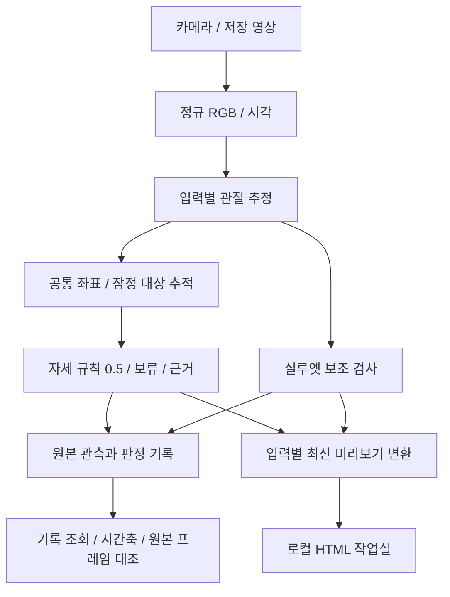

# 시스템 구조

[문서 목차](../README.md) · [분야 목차](README.md) · [현재 상태](../PROJECT_STATUS.md)

[문서 목차](../README.md) · [코드 구성](CODE_DESIGN.md) · [요구사항](../REQUIREMENTS.md)

**기준일: 2026-10-29.** 현재 구현과 목표 구조를 구분합니다. 자세·이탈/복귀의 상태 전이 제안과 실패 사례는 [이전 구조 설계](https://github.com/zntks1234/bed-pose-skeleton-ai/blob/98b1529bfea26f4679f9b19d3744d5c4f122d0da/docs/archive/ARCHITECTURE_BEFORE_REORGANIZATION.md)에 보존했습니다.

## 현재 구현 흐름

입력별 LiveWorker가 수신·추론·기록을 소유합니다. 표시용 인코더는 별도이며 영상·관절·실루엣을 같은 프레임 묶음으로 전달합니다. 원본 카메라 영상 녹화는 아직 제공하지 않습니다.

## 두 카메라의 현재 범위

운영자가 같은 사람을 지정하고 잠정 추적·수신 시각 조건을 확인한 뒤 양쪽 라벨이 일치하면 통합 결과를 냅니다. 단일 시점의 보류를 다른 쪽 관절로 복원하는 방식은 아직 없습니다. 수신 시각 정렬은 촬영 노출 동기화가 아닙니다. [그룹 계약](MULTI_CAMERA_DESIGN.md) · [통합 관측 자료](TWO_VIEW_INPUTS.md).

## 최종 목표와 미완성 부분

| 목표 | 현재와의 차이 |
|---|---|
| 관절 품질 기반 신뢰성 | 좌표 가용성과 실제 정확도가 다름. 품질/오판정 평가 필요 |
| 안정·변화 후보·보류 | 현재 자세는 프레임별 판단. 시간적 안정화와 이벤트 분석 후속 |
| 침대 점유·이탈·복귀 | 미검출을 이탈로 단정하지 않는 별도 상태/시점 정책 필요 |
| 침대 자동 인식·녹화·순차 계획 | 수동 영역·개별 자유/그룹 단일 계획에서 확장 필요 |
| 외부 센서 비교 | 공통 라벨·시간 매핑과 비교 범위 합의 필요 |

카메라 예측과 외부 ToF/mmWave는 독립 경로로 생성합니다. 목표·AI 예측·센서 결과·실제 정답은 별도 데이터이며, 일치도와 정답 기준 정확도도 별도로 평가합니다. [데이터·평가 설계](DATA_AND_VALIDATION.md).
