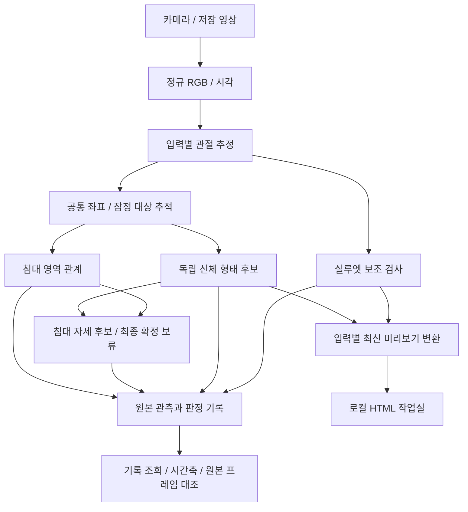

# 시스템 구조

[문서 목차](../README.md) · [분야 목차](README.md) · [현재 상태](../PROJECT_STATUS.md)

[문서 목차](../README.md) · [코드 구성](CODE_DESIGN.md) · [요구사항](../REQUIREMENTS.md)

**기준일: 2026-10-29.** 현재 구현과 목표 구조를 구분합니다. 자세·이탈/복귀의 상태 전이 제안과 실패 사례는 [이전 구조 설계](https://github.com/zntks1234/bed-pose-skeleton-ai/blob/98b1529bfea26f4679f9b19d3744d5c4f122d0da/docs/archive/ARCHITECTURE_BEFORE_REORGANIZATION.md)에 보존했습니다.

## 현재 구현 흐름

입력별 LiveWorker가 수신·추론·기록을 소유합니다. 표시용 인코더는 별도이며 영상·관절·실루엣을 같은 프레임 묶음으로 전달합니다. 선택적으로 분석한 카메라 프레임을 영상으로 저장하고 각 로그 행에 대응시킵니다. 수신한 모든 프레임의 연속 녹화는 제공하지 않습니다.

위 흐름은 일반 입력의 기본 0.7입니다. 선택적 0.8은 별도 영상 근거 제공자로 누움·앉음·서 있음/누운 방향을 받아 최종 예측을 조합하는 계약을 추가했습니다. CLIP ViT-B/16 제공자를 구현했고 사전학습 가중치는 별도 준비합니다. 준비된 CLIP 입력은 0.8이 기본 선택되고 미사용은 0.7입니다. 사전학습 실행/정확도 검증은 남아 있습니다. 누운 방향은 침대 영역과 독립이고, 걸터앉음만 앉음+영상상 가장자리 관계를 조합합니다. 프로필·현재 대상/프레임·관측 시각과 원본 관측을 기록하고 저장 근거로 재계산합니다. [상세 계약과 검증 공백](AUTOMATIC_POSTURE.md).

## 두 카메라의 현재 범위

두 카메라 그룹은 침대 영역을 확인하고 시작하며, 각 화면에 침대 안 사람이 한 명씩 보이고 수신 시각 조건을 통과하면 CLIP 점수를 결합합니다. 두 관측이 동일인인지 인증하지는 않습니다. 이전 수동 지정 그룹의 기록과 재검사는 유지합니다. 단일 시점의 보류를 다른 쪽 관절로 복원하는 방식은 아직 없습니다. 완료된 기록에는 별도 보정값을 이용한 3D 관절 근거 내보내기가 가능하지만, 선택적 기록 내보내기에서는 기존 3D 기하 규칙으로 깊이를 판정에 반영합니다. 실시간 판정에는 연결되지 않았습니다. 수신 시각 정렬은 촬영 노출 동기화가 아닙니다. [그룹 계약](MULTI_CAMERA_DESIGN.md) · [통합 관측 자료](TWO_VIEW_INPUTS.md).

## 최종 목표와 미완성 부분

| 목표 | 현재와의 차이 |
|---|---|
| 관절 품질 기반 신뢰성 | 좌표 가용성과 실제 정확도가 다름. 품질/오판정 평가 필요 |
| 안정·변화 후보·보류 | 현재 자세는 프레임별 판단. 시간적 안정화와 이벤트 분석 후속 |
| 침대 점유·이탈·복귀 | 미검출을 이탈로 단정하지 않는 별도 상태/시점 정책 필요 |
| 침대 자동 인식·녹화·순차 계획 | 수동 영역·개별 자유/그룹 단일 계획에서 확장 필요 |
| 외부 센서 비교 | 공통 라벨·시간 매핑과 비교 범위 합의 필요 |

카메라 예측과 외부 ToF/mmWave는 독립 경로로 생성합니다. 목표·AI 예측·센서 결과·실제 정답은 별도 데이터이며, 일치도와 정답 기준 정확도도 별도로 평가합니다. [데이터·평가 설계](DATA_AND_VALIDATION.md).

## 시점 자유도를 높이는 설계 제안

**목표:** 특정 설치 위치·방향을 필수 조건으로 고정하지 않고 판정합니다. 수동 사선/위 시점 선택을 기본 흐름에서 제거하는 방향입니다. 세션 중 카메라는 고정하며, 연속 이동 지원은 별도 요구입니다. 아래는 구현·성능이 확인되지 않은 제안입니다.

### 이전 0.5의 의존성

`automatic_posture.py`의 `_evaluate_v3`는 몸통 세로 비율, 어깨/골반의 화면 위아래 관계, 허벅지의 화면 수평 여부, 발목의 화면 아래 여부로 누움/걸터앉음의 진입 조건을 정합니다. 0.5도 이 경로를 사용하므로 최종 가중 점수만 조정해 시점 의존성을 없앨 수 없습니다. `view=overhead`는 걸터앉음을 구분하지 못하고, 단안 추정 3D도 침대 법선·실제 중력 방향을 제공하는 보정값으로 취급할 수 없습니다.

### 적용 후보와 한계

| 후보 | 해결하려는 문제 | 남는 한계·검증 |
|---|---|---|
| 몸통 축에 대한 어깨/골반 투영·내적·각도·정규화 비율 | 화면 회전과 체격 크기에 대한 의존성 축소 | 2D 좌표의 회전 불변성이 카메라 시점 변화 불변성을 뜻하지 않음. 단축·가림은 남음 |
| 침대 면 상대 위치·가장자리 관계 | 화면 고정 좌표 대신 침대와 사람의 관계 활용 | 네 점 호모그래피는 평면 대응이며 침대 위 높이·중력·관절 3D를 복원하지 않음 |
| 선택적 추정 3D·얼굴/외형·실루엣 단서 | 투영이 비슷한 자세를 보조 구분 | 모델 추정 오차·공통 실패가 있고 같은 모델의 출력은 독립 근거가 아님. 사용 전 비교 필요 |
| 시점/관측 품질에 따른 근거 선택 | 사용자 모드 선택 없이 관측 가능한 정보를 사용 | 자동 시점 추정 방법·품질 기준은 미정. 같은 2D 투영으로 구분 불가능한 경우 보류 필요 |
| 두 시점의 보완 활용 | 한 시점의 가림·단축 보완 | 단일 카메라 사용을 유지하고 추가 카메라는 선택. 동일인·시간·품질 검증 선행 |

네 점은 현재 어느 모서리부터든 찍을 수 있으므로 물리적인 머리/발 방향이나 공통 3D 축이 자동으로 정해지지 않습니다. 평면 상대 좌표만으로 자유 시점 판정이 완성된다고 가정하지 않습니다. 실제 보정이 필요하면 사용자 부담과 자동화 가능성을 함께 평가합니다.

### 진행·검증 방식

1. 현재 0.5를 비교 기준선으로 보존하고 시점에 의존하는 진입 조건·방향 특징을 각각 점검합니다.
2. 화면 회전/크기 변화에 대한 특징 검사와 실제 카메라 위치 변경 실험을 구분합니다. 전자는 영상 투영·가림의 변화를 재현하지 못합니다.
3. 같은 자세를 양옆·머리/발 방향·사선·높은 시점·기울어진 화면에서 확인합니다. 사람/세션과 평가용 설치 조건을 분리하고 범위 밖 서 있음·전환·가림도 포함합니다.
4. 시점별 오분류·보류율·관절 실패를 비교합니다. 평균 결과만으로 특정 시점 실패를 숨기지 않습니다. 추정 3D/보조 영상 단서의 추가 이득도 따로 확인합니다.
5. 근거가 확인된 후보를 새 버전으로 연결하고 특징·사용 근거·설정·보류 사유를 기록합니다. 목표·정답·센서 출력은 예측 입력에서 계속 제외합니다.

새 가중치·임계값·자동 시점 알고리즘은 이 문서에서 확정하지 않습니다. 기존의 수동 침대 영역 지정은 유지 가능한 준비 절차이며, 수동 촬영 시점 선택의 제거와 구분합니다. 현재 지원 시점과 사용법은 [자동 판정](AUTOMATIC_POSTURE.md)을 따릅니다.

### 이전 0.6 구현 · 2026-10-29

`viewpoint_posture.py`는 비교용 0.6의 침대 면/핀홀 추정·3D 대응을 담당합니다. 현재 기본은 `separated_posture.py`의 0.7이며 신체 형태·침대 영상상 관계·최종 해석을 분리합니다. 신체 입력에는 영역이 없고 영역 모듈에는 자세 라벨이 없습니다. 형태 후보와 영상 겹침만으로 실제 누움·점유를 확정하지 않습니다. [현재 계약과 제한](AUTOMATIC_POSTURE.md).
