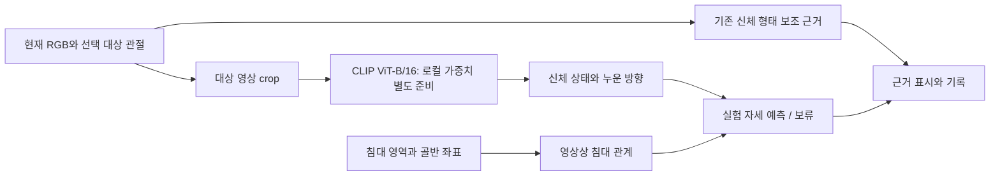

# 기준 등록 없는 자동 자세 판정 · 실험용 규칙

[문서 목차](../README.md) · [분야 목차](README.md) · [현재 상태](../PROJECT_STATUS.md)

기준 자세 등록 없이 관절 기하 또는 선택적 CLIP 이미지 근거를 사용하는 실험용 경로입니다. 현재 기본과 이전 버전은 아래에서 구분합니다. 실제 성능이 검증된 범용 침대 자세 분류기는 아닙니다.

## 독립 자세 판단 0.8 · CLIP 제공자 구현, 사전학습 성능 미검증

2026-10-29 근거 제공 계약·최종 조합·평가 도구를 구현했고, **2026-10-30 사용자 요청으로 CLIP ViT-B/16 제공자·모델 준비 명령·HTML 선택·실제 입력/점수 표시를 추가했습니다.** 실제 CLIP 로딩/연산 코드는 구현했으며 사전학습 가중치는 별도 준비해야 합니다. 준비된 입력은 CLIP 0.8을 기본 선택하고, 미준비 또는 입력 추가에서 CLIP을 끄면 기존 0.7입니다. 이 환경에서는 Hugging Face 접속이 프록시 403으로 차단돼 사전학습 가중치 추론·자세 정확도를 검증하지 못했습니다. [설치와 사용](../guides/LIVE_MEASUREMENT.md#clip).

### 1. 누움·앉음·서 있음의 판단 근거

정면 형태는 서 있는 사람에게도 나타나고, 고관절·무릎 굽힘은 웅크려 누움에도 나타납니다. 따라서 0.7의 형태 라벨을 실제 누움/앉음으로 이름만 바꾸지 않습니다. 침대 면·화면 세로축·MediaPipe z를 실제 중력으로 대체하지 않습니다. 검토한 문헌의 적용 범위는 [근거 조사](../research/LITERATURE_REVIEW.md#posture-architecture-evidence-2026-10-29)를 따릅니다.

| 대안 | 가능한 역할 | 현재 판단·남은 조건 |
|---|---|---|
| 관절의 상대 배치만 사용 | 신체 형태·굽힘·방향 후보 | 중력/지지와 시점 모호성이 남아 단독 최종 상태 근거로 채택하지 않음 |
| 사전학습 영상 모델의 사람 영상 해석 | 누움·앉음·서 있음 및 누운 방향의 독립 관측 경로 | CLIP ViT-B/16을 첫 실험용으로 구현. 최종 모델 선정·침대 정확도·시점/가림·장치 지연·실제 자산 검증은 별도 |
| 침대와 독립된 카메라 방향 보정 + 추정 3D | 중력 방향과 몸통/팔다리의 기하 비교 | 선택적 비교 후보. 현재 보정값/자동 취득 경로가 없으며 사용자 시점 선택을 필수로 추가하지 않음 |
| 기존 실루엣 | 관절·인물 영역의 일치 검사 | 같은 모델의 보조 출력이며 독립 자세 정답/중력 근거가 아님 |

영상 후보의 예로 CLIP 계열의 이미지·텍스트 유사도 기반 분류를 검토할 수 있습니다. 이는 **추가 학습 없는 실험 후보 제안**입니다. [공식 모델 카드 Model Details](https://github.com/openai/CLIP/blob/main/model-card.md)는 zero-shot 분류 연구 목적과 적용 맥락별 검토 필요성을 설명합니다. 이번에는 이 소프트웨어 문서의 해당 절을 확인했으며 논문 전체 검증·우리 침대 환경 성능 확인·모델 채택은 하지 않았습니다. 유사도나 선택지 softmax를 자세 정답 확률로 해석하지 않습니다. 0.8 계약을 만든 당시에는 새 실행 라이브러리를 도입하지 않았습니다. 후속 CLIP 구현은 선택 의존성인 PyTorch·Transformers·Pillow를 사용하며 기본 설치에는 강제하지 않습니다.

### 2. 출력과 조합 규칙

| 근거 | 최종 동작 |
|---|---|
| 신체 상태 `lying` + 영상의 누운 방향 `supine`/`side` | 해당 자세를 실험 예측. 영역 미지정·밖·오류가 신체 자세를 막지 않음 |
| `lying`이나 방향 `unknown` | 신체 상태 ‘누움’을 보존하고 방향 판정만 보류. 정면 형태로 바로 누움을 채우지 않음 |
| `sitting` + 영상상 침대 가장자리 | `edge_sitting` 실험 예측. 영상 겹침 기반이므로 실제 지지/점유 확정은 아님 |
| `sitting` + 관계 미확인/안쪽/밖 | 신체 상태 ‘앉음’ 보존, 걸터앉음 라벨 보류 |
| `standing` / `other` / `prone` 방향 | 상태·근거는 보존하고 초기 세 라벨에 강제 배정하지 않음. 이탈 이벤트를 생성하지 않음 |
| 모델 미연결·처리 실패·unknown·대상/프레임 불일치 | 보류 사유 기록. 마지막 상태 재사용이나 0.7 형태의 자동 승격 없음 |

**예측과 정답 확인은 다릅니다.** 0.8은 유효한 영상 근거가 오면 `status=predicted`를 출력할 수 있지만 `physical_posture_verified=false`, 실제 점유 unknown은 유지합니다. 정답 확인 여부를 모든 AI 예측의 필수 조건으로 두지 않습니다. 초기 최종 라벨은 바로 누움·옆누움·걸터앉음을 유지하며, 앉음·서 있음 등은 내부 신체 상태입니다.

### 3. 제공자·기록 계약

- `body_state.py`의 제공자는 `estimate(ImageBodyInput)`과 `close()` 및 명시적 `profile`을 구현합니다. `LiveEngine(..., body_state_provider=...)`에 입력별로 연결할 수 있습니다. **현재 MediaPipe 어댑터가 이 제공자를 구현한 것은 아닙니다.** CLIP은 별도 `clip_posture.py`가 구현하며, MediaPipe 관절 추정과 다른 역할입니다.
- 입력은 현재 프레임·시계·선택 대상 ID·대상 관절에서 만든 crop과 crop 상대 관절입니다. 관측 관절 상자를 10% 확장하는 전처리를 버전으로 고정합니다. 침대 영역·목표·GT·ToF/mmWave 결과는 제공자에게 전달하지 않습니다. 배경의 침대 픽셀까지 제거됐다는 뜻은 아니며 배경/시점 변화 시험이 필요합니다.
- 대상 관절이 거의 없거나 crop이 퇴화하면 제공자 호출을 보류합니다. 다른 사람의 crop 혼입·관절 오검출·가림은 실제 자료의 평가 과제입니다. 모델이 대상 선택을 대신해 준다고 가정하지 않습니다.
- 상태는 `lying/sitting/standing/other/unknown`, 누운 방향은 `supine/side/prone/unknown`입니다. 단일 모델·복수 모델 중 어느 구성이 나은지는 미정입니다.
- 모델 ID·가중치 SHA-256·전처리 ID·`decision_policy`·실제/합성 실행 구분을 프로필과 모델 식별자에 반영합니다. logits·유사도·미보정 확률·점수 미제공을 구분합니다. 제공자의 선택/보류 정책을 기록하며 기존 형태 점수 0.65를 영상 점수에 그대로 적용하지 않습니다.
- 일반 제공자 계약은 SHA-256 형식과 출처를 검사합니다. CLIP 구현은 추가로 준비 시와 로딩 직전에 가중치·구성·토크나이저 파일의 실제 해시를 대조합니다. 로컬 반입 자산의 해시 일치는 공식 원본과의 동일성 인증이 아니며 `local_import`·revision null로 기록합니다.
- 원본 관측 `body_state_observation`과 제공자 프로필, 처리 시작/완료 시각을 기록합니다. 프레임·수신 시각·대상·프로필을 검증하고 저장 근거에서 조합을 재계산합니다. 검사 통과는 모델의 실제 정확도/정직한 출력을 증명하는 인증이 아닙니다.
- live-0.3-draft의 0.8 기록만 새 관측을 요구합니다. 과거 0.1–0.7 계산을 변경하지 않습니다. 제공자가 없으면 새 선택지는 기본 UI에서 숨기고 기존 0.7 형태 표시를 유지합니다.

### 4. 실제 영상 검증 계획과 현재 공백

1. 같은 사람·카메라에서 바로 누움·옆누움·걸터앉음·서 있음·일반 앉음·웅크려 누움·전환을 수집하고 실제 수행을 별도로 검토합니다. 카메라 위치/기울기·가림·주변 인물 조건을 기록합니다.
2. 사람/세션 및 미관측 설치 조건을 분리합니다. 같은 사람의 인접 프레임을 학습/정책 조정/시험에 섞지 않습니다. 모델·가중치·프롬프트·crop·선택/보류 정책을 고정합니다.
3. 신체 상태 confusion과 초기 세 자세 confusion을 별도 평가합니다. 보류를 누락으로 포함한 recall/F1, 출력 구간 정확도와 coverage, 서 있음 등 범위 밖 오수락률을 함께 봅니다. 점유·이벤트 정확도로 바꾸어 해석하지 않습니다.
4. 실제 정답 주석이 있는 경우에만 `posture-evaluate`로 계산합니다. 없으면 `not_evaluated_no_reviewed_labels`를 출력합니다. 전체 세 자세가 주석에 없으면 전체 macro-F1도 비웁니다. [주석 형식과 명령](../guides/RECORD_REVIEW.md#posture-accuracy).

현재 이 환경의 Hugging Face 다운로드가 프록시 403으로 차단돼 **사전학습 가중치 추론과 실제 자세 정확도 평가는 수행하지 못했습니다.** 실제 Transformers CLIP 연산 경로는 작은 무작위 가중치 모델로 검사하고, 연결·기록·브라우저는 명시적인 테스트 대역으로 검사합니다. 업로드한 마네킹 표본을 모델로 분류하거나 관절 정답과 비교했다고 보고하지 않습니다. 남은 순서는 사전학습 자산 준비 → 마네킹/별도 검토한 사람 자료 평가 → 같은 자료의 SigLIP 2 비교 → 최종 모델 판단입니다.

### CLIP 제공자 세부 계약 · 2026-10-30

- 모델은 `openai/clip-vit-base-patch16`입니다. `clip-setup`이 HF 요청 revision을 전체 commit SHA로 먼저 고정한 뒤 PyTorch 가중치와 지정 구성/토크나이저 파일만 내려받고 `bedpose_clip.json`에 파일 해시를 남깁니다. `--source`는 이미 확보한 HF 형식 폴더를 반입하며 공식 revision으로 가장하지 않습니다. 기존 출력 폴더를 덮어쓰지 않고 실패 시 미완성 폴더를 정리합니다.
- 분석 중에는 `local_files_only=True`로 읽고 이미지나 문장을 외부 API로 전송하지 않습니다. 가중치 pickle은 PyTorch `weights_only` 로더로 읽습니다. CLIP은 입력별 Worker에서 모델을 로딩하며, CPU float32가 기본이고 명시적으로 CUDA를 선택할 수 있습니다. 자동 CPU/GPU 전환은 하지 않습니다. 입력마다 모델이 있으므로 복수 입력의 메모리/지연은 실측 과제입니다.
- 같은 대상의 현재 RGB 관절 crop을 **비율 유지해 224px 안에 맞추고 CLIP 평균색 여백으로 정사각형을 구성**합니다. 중앙 잘라내기를 끄고 RGB 정규화를 적용합니다. crop 이후의 전처리에서 신체 양끝을 추가로 자르지 않지만, 원래 관절 crop의 누락은 해결하지 않습니다. 실루엣은 입력/점수에 사용하지 않습니다. 여백 방식의 인식 이득도 아직 미검증입니다.
- 고정 영어 문장을 상태별로 인코딩·정규화·평균 후 재정규화해 입력 연결 시 한 번 보관합니다. 매 프레임 이미지 특징은 한 번 계산해 누움/앉음/서 있음/기타 및 바로/옆/엎드림 두 그룹과 비교합니다. 이미지 전체 특징을 쓰며 관절 간 높이·픽셀 중력을 실측하는 모델은 아닙니다.
- 그룹별 softmax의 최고값을 선택합니다. 상태와 방향 각각 **0.5 이상**, 동점 허용 오차 **1e-8**은 **자료로 보정하지 않은 구현 초기값**입니다. 근접 2위와의 차이를 별도 기권 조건으로 쓰지 않습니다. `--clip-state-min`·`--clip-direction-min`으로 설정하고 프로필에 저장합니다. 0.5는 기존 관절 적합도 0.65와 무관합니다. softmax와 기타 문장은 범위 밖 탐지의 보증이 아닙니다.
- 누움이 선택된 경우에만 방향을 사용합니다. 방향 부족은 누움 상태를 보존하고 방향 보류, 엎드림·서 있음·기타는 초기 세 최종 라벨에 강제 배정하지 않습니다. 신체 상태 자체가 부족하면 unknown입니다. 시간적 평활화·마지막 라벨 재사용은 하지 않습니다.
- `decision.details`에 7개 cosine 원점수·모델 logit scale·방향 상대점수·사유를 보존하고, 일반 `scores`에는 네 상태의 미보정 상대점수를 기록합니다. 문장·선택 기준·전처리·장치·라이브러리 버전·자산 해시는 제공자 프로필에 보존합니다. 재검사는 **저장 원점수와 당시 정책에서 결정/상대점수를 재계산**하며 모델 추론을 재실행하지 않습니다. 저장 원점수가 실제 모델에서 생성됐다는 인증은 아닙니다.
- HTML의 ‘CLIP 이미지 판단 근거’에 상대점수·초기 기준·실제 224×224 입력을 표시합니다. 입력 이미지는 같은 프레임/대상의 일시 미리보기이며 JSONL/CSV에 저장하지 않습니다. 격자/관측 중단/처리 실패에서 이전 입력 이미지를 현재로 재사용하지 않습니다. 모델 실패는 보류로 남기고 관절/기록 처리는 계속합니다. 모델 로딩 실패는 해당 입력의 명시적 오류이며 모의 모델로 대체하지 않습니다.
- 공식 [CLIP 모델 문서](https://huggingface.co/openai/clip-vit-base-patch16), [설정·전처리](https://huggingface.co/openai/clip-vit-base-patch16/tree/main), [Transformers CLIP API](https://huggingface.co/docs/transformers/v4.57.6/en/model_doc/clip)의 기능에 근거한 구현입니다. 논문 전체 검증·침대 정확도·자유 시점 성능이 검증됐다는 의미는 아닙니다.

## CLIP 미사용 기본 0.7 · 신체 형태와 침대 관계 분리

2026-10-29 사용자 요청에 따라 `separated_posture.py`의 세 출력을 분리했습니다. **침대 영역을 신체 형태의 입력으로 사용하지 않습니다.** CLIP 미사용 입력의 기본과 설정 `auto`는 0.7입니다. CLIP을 연결한 입력의 `auto`는 0.8이며, 이전 0.6은 `bed_auto`로 선택합니다.

| 출력 | 입력·의미 | 실패 처리 |
|---|---|---|
| `body_assessment` | 같은 대상의 2D/선택적 추정 3D. 정면 형태·옆면 형태·앉은 형태 후보 | 관절/대상 부족은 보류. 침대 없음·영역 밖·영역 변경은 신체 결과를 바꾸지 않음 |
| `bed_relation` | 골반 두 점과 침대 영역의 영상상 내부·가장자리·외부·경계 관계 | 영역/골반 부족은 unknown. 실제 점유는 항상 unknown이며 이탈 이벤트가 아님 |
| `context_assessment` | 형태와 영역 관계를 조합한 침대 자세 **후보** | 영상 겹침을 실제 지지·누움·걸터앉음 확정으로 승격하지 않음 |

기존 0.5의 몸통 상대 2D/추정 3D 적합도와 0.65 기준·근접 2위 허용 정책을 형태 후보에 재사용합니다. 점수는 바로/옆누움 확률이 아닙니다. 앉은 형태는 추정 3D의 양쪽 고관절·무릎 굽힘을 사용하고 기존 65–135도·90도 적합도 범위를 초기값으로 적용합니다. 새 고관절 특징은 미검증이며 웅크려 누움과 혼동할 수 있어 실제 앉음을 확정하지 않습니다. 3D/해당 2D 관절이 부족하면 앉은 형태 점수를 계산하지 않습니다.

**기능 경계:** 0.7은 신체 형태 후보를 출력하지만 최종 `posture_assessment.label`은 `null`, 상태는 `held`로 남깁니다. 중력·지지 상태를 판별할 독립 근거는 후속입니다. 따라서 기존의 세 자세 확정 라벨과 두 카메라 라벨 일치 결과는 새 기본 모드에서 나오지 않습니다. 기존 0.6 예측이 필요하면 비교 모드를 선택할 수 있습니다. 기존 0.1–0.6의 계산·기록 재현은 유지합니다.

화면·원본 기록·기록 조회·CSV는 형태 후보와 침대 관계를 구분합니다. 영역 없이 개별 측정을 시작하고 이후 영역을 지정/변경할 수 있습니다. `live-0.3-draft`는 시작 영역·선택 메타데이터 null 및 초기 영역 revision 0을 지원하며 기존 live-0.1/0.2 읽기를 유지합니다. 두 카메라 그룹의 시작 준비 조건은 유지하며 후보 일치만으로 최종 자세를 확정하지 않습니다.

## 이전 규칙 0.6 · 침대 면과 추정 3D 대응

2026-10-29 도입한 이전 경로입니다. 설정에서 ‘이전 0.6 · 침대/3D 대응’을 선택하면 사용합니다. 수동 시점 선택 없이 침대 네 점과 같은 후보의 MediaPipe 추정 3D를 영상에 대응시킵니다. 특정 시점의 실측 정확도를 확보했다는 뜻은 아닙니다.

1. 네 점을 실제 직사각형 침대 면의 투영으로 가정합니다. 영상 중심 주점·정사각 픽셀·왜곡 없음의 핀홀 카메라를 가정하며, 직교 소실 방향에서 가능한 초점거리를 추정합니다. 식이 퇴화하거나 범위 밖이면 긴 변 길이의 초점거리 사전값을 사용합니다. `calibration_verified=false`로 기록하며 보정 실측값이 아닙니다.
2. 같은 사람의 원본 3D와 유효 2D 관절 최소 6개를 SQPnP/LM으로 대응시킵니다. 전방 깊이·몸통 길이 대비 재투영 오차·침대 축 직교 조건을 검사합니다. 가림 속 관절의 실제 정확도를 보증하지 않습니다.
3. 대응된 몸통 축과 침대 면 법선의 내적으로 누움/세움 후보를 구분합니다. 누움에서는 어깨·골반 방향의 침대 법선 성분을 비교합니다. 걸터앉음은 3D 무릎 굽힘·침대 방향의 허벅지·침대 아래로 향하는 종아리·영상상 가장자리 관계를 검사합니다.
4. 0.65 최소 기준·근접 2위 허용·어깨/골반 및 앉음 가중치는 유지합니다. 새 누움 점수는 침대 법선에 대한 3D 성분으로 계산하며 이전 2D/3D 점수 혼합을 사용하지 않습니다. 동일한 숫자의 가중치라도 특징 의미가 바뀌었으므로 이전 점수와 동일 척도라고 해석하지 않습니다.
5. 대응 없음·관절 부족·영역 밖·모호성은 보류합니다. 모델 3D가 없다고 과거 화면 축 규칙으로 자동 전환하지 않습니다. 실루엣은 계속 별도 보조 근거입니다.

`auto_focal_prior=1`, 침대 축 직교 내적 오차 최대 0.15, 법선 카메라 깊이 성분 최소 0.08, 재투영 RMS/몸통 길이 최대 0.08은 **검증되지 않은 구현 초기값**입니다. 모두 프로필에 보존합니다. 원본 관절·좌표 대응 행렬·오차·침대 법선·사용한 사전값/추정 방법·최종 점수를 기록합니다. 목표·GT·외부 센서는 사용하지 않습니다.

평면 대응만으로 사람 높이를 측정하는 방식이 아닙니다. 잘못된 네 점·비직사각 침대·렌즈 왜곡·강한 단축·미러 영상·잘못된 모델 3D에서 틀리거나 보류될 수 있고, 낮은 재투영 오차도 실제 정답을 보장하지 않습니다. 평행 소실 방향에서는 사전 초점거리와 실제 카메라의 차이가 특히 중요합니다. 침대의 보이는 윗면을 촬영하고 세션 중 카메라 고정 조건을 유지합니다. 전 시점에서 같은 정확도를 보장하지 않습니다.

## 이전 규칙 0.5: 가중 적합도 · 2026-10-28

이전 자동 0.5는 자세별 독립 적합도를 계산해 최고 점수가 최소 기준 이상이면 출력합니다. 1·2위 차이는 기권 조건이 아니며 가까움 안내만 표시합니다. 2D·추정 3D 가중 결합과 걸터앉음 근거 점수를 화면·원본·CSV에 기록하고, 기존 0.1~0.4 판정/기록은 그대로 재현합니다. 필수 관측과 기존 자세 진입 조건은 유지합니다. [현재 수식·초기값·한계](WEIGHTED_POSTURE.md).

## 이전 구현 이력: 규칙 0.4 · 2026-10-28

0.4 도입 당시 기본은 몸통 기준 2D와 같은 후보의 추정 3D를 사용하는 규칙이었습니다. 현재 기본은 위의 0.5입니다. 어깨·골반 축의 일관성을 검사하고, 2D가 애매하면 3D를 보조로 바로 누움/옆누움을 판정합니다. 명확한 충돌은 보류합니다. 새로운 파라미터와 근거 경로를 프로필/판정에 기록하며 0.1~0.3은 당시 로직으로 검증합니다. 아래 0.3의 자세·침대·시점 조건을 유지하고 누운 방향 구분 경로를 확장한 것이며, 실제 정확도는 미검증입니다. [0.4 당시 규칙·초기값·한계](../archive/LYING_ORIENTATION_RULES.md).

## 이전 구현 이력: 로직 검수와 규칙 0.3 · 2026-10-28

누움 판단에 사용하지 않는 무릎 각도 계산 실패가 전체 프레임을 보류하던 경로를 수정했다. 계산 불가 하체 정보는 원본과 판정 근거에 보존하고, 앉음·서 있음에 하체가 필요한 경우는 계속 보류한다. 중간 몸통 방향을 하체 부족과 구분한다. 임계값과 기존 시점 가정은 유지하며 이전 0.1·0.2 기록은 당시 규칙으로 검사한다. [검수 결과·남은 위험](../reviews/AUTOMATIC_POSTURE_REVIEW.md)을 확인한다.

## 네 점 침대 영역 · 2026-10-28

침대 모서리를 순서대로 네 번 클릭해 지정하고 점 이동·마지막 점 취소·지정 취소를 지원합니다. 볼록 영역 검사, 실제 다각형 내부 여부, 단위 사각형 대응 상대 좌표와 자동 자세 판정/원본·그룹 기록 검사를 연결했습니다. 기존 사각형 기록은 유지하며 네 점을 포함한 통합 입력은 0.3 형식입니다. [사용법과 좌표 의미](../guides/BED_REGION.md).

## 사용법

1. 기존처럼 `python -m bed_pose live`로 실행하고 카메라 또는 저장 영상을 연결한다.
2. 기본은 **신체 형태 · 침대 관계 분리**입니다. 영역 없이도 신체 형태 후보를 보고 개별 기록을 시작할 수 있습니다.
3. 침대 관계가 필요하면 네 점을 지정합니다. 기본 모드는 침대 면의 3D 방향을 계산하지 않습니다. 이전 0.6은 영역·추정 3D 대응이 필요합니다.
4. ‘영상과 추정 3D 관절의 대응 불확실’ 또는 ‘침대 면 방향 추정 불확실’이면 네 점·관절 표시·촬영 상태를 확인합니다. 사유는 추정의 실패이며 실제 자세의 부재를 뜻하지 않습니다.
5. 설정에서 판정을 끄거나 이전 사선/위 방식을 비교용으로 선택할 수 있습니다. 진행 중에는 종료 후 설정을 변경합니다. 아래 0.1~0.5 설명은 이전 경로의 계약입니다.

합성 데모는 실제 사람 분류 자료가 아니므로 기본 판정은 꺼져 있다. 설정으로 실험할 수 있으나 실제 정확도 검증이 아니다. 파일 일시정지 중 설정 변경은 다음 재생 프레임부터 판정에 반영한다. 카메라 이동 후에는 침대 영역과 시점을 다시 확인해야 한다.

## 유지한 0.3 조건과 이전 방향 기준

`automatic_posture.py`의 버전과 전체 실험 설정을 manifest에 남긴다. 입력은 기존 PostureInput의 화면 내 유한한 관절 좌표·영상 크기·침대 영역이다. 목표·정답·외부 센서·파일명은 사용하지 않는다. 이전 0.3 규칙은 좌우 어깨·골반 4관절을 필수로 사용한다. 사선 모드에서 몸통이 기존 누움 조건(세로 비율 ≤0.55)에 해당하면 하체 누락이나 투영 각도 계산 실패와 별개로 몸통의 누운 방향을 판단할 수 있다. 세로 몸통의 앉음·서 있음 구분에는 양쪽 유효 하체가 필요하며 중간 방향은 시점/몸통 방향 불확실로 보류한다. 위 시점의 양쪽 무릎 굽힘 보류와 비수평 몸통/불완전 하체 보류를 유지한다. 바로 누움 후보에는 코·양쪽 눈도 필요하다. 미검출·대상 혼동·추적 보류는 기존 게이트를 유지한다.

| 항목 | 현재 실험 설정 | 사용 목적 |
|---|---|---|
| 몸통 세로 비율 | 사선/측면: 0.85 이상 세로 후보, 0.55 이하 누움 후보 | 화면 내 몸통 방향; 실제 중력축 측정 아님 |
| 너비/몸통 길이 | 양쪽 어깨·골반 비율 모두 0.22 이하 옆누움 후보, 모두 0.40 이상 바로 누움 후보 | 폭의 투영 차이; 중간/불일치 구간 보류 |
| 무릎 각도 | 양쪽 155° 이상과 수직 배치: 서 있음 등 보류 후보 | 서 있음을 세 자세에 억지로 배정하지 않는 초기 검사 |
| 앉음 후보 | 양쪽 무릎 65~135°, 세로 몸통·가로 허벅지·무릎 아래 발목 | 사선/측면 걸터앉음의 초기 기하 조건 |
| 침대 관계 | 골반이 사각형 내부이며 정규화 가장자리 거리 ≤0.18 | 걸터앉음 후보 제한. 실제 물리 경계 정답 아님 |

위 값은 **자료로 검증하지 않은 구현 초기값**이다. 논문의 검증된 규칙이나 성능 최적값이 아니다. 바로 누움 후보에는 해부학적 좌우 어깨/몸통의 투영 방향도 검사하지만, 이는 약한 앞뒤 단서일 뿐 엎드림 검출기의 성능을 확보한 것이 아니다. 0 좌표와 결측을 구분하며 관절을 보간하거나 점수 임계값으로 올바른 관절임을 보증하지 않는다. 현재 프레임만 사용하고 시간 평활화는 하지 않는다.

## 한계

- 사선/측면에서도 머리·다리 방향이 주로 화면 세로로 보이는 누움은 보류될 수 있다. 화면 세로축과 실제 중력 방향이 다르면 서 있음/앉음 검사도 부정확해진다.
- 위 시점에서는 서 있는 사람과 누운 사람의 2D 투영이 비슷할 수 있다. 해당 모드는 중력 방향·침대 지지 상태를 알아내지 못하므로 잘못된 누움 판정이 가능하다.
- 바로 누움/옆누움의 폭 비율은 체형·원근·시점·관절 오검출에 영향을 받는다. 등을 보이거나 엎드린 사람도 얼굴 관절이 잘못 출력되면 오분류할 수 있다.
- 사각형 안에 보인다는 사실이 침대에 실제로 올라가 있다는 뜻은 아니다. 의자/바닥 앉기, 웅크림 등 등록하지 않은 자세의 완전한 거부 기능은 아니다.
- 관절이 모두 출력돼도 가림 속 추정이 틀릴 수 있다. 안정성·보류율·자세별 정확도는 실제 정답 자료로 확인해야 한다. 실사용/임상 성능을 주장하지 않는다.

## 두 카메라와 기록

양쪽 입력에 침대 영역을 설정하고(자동은 시점 선택 불필요), 기존처럼 대상 지정·운영자 동일인 확인·수신 시각 허용 차이를 설정해 그룹을 시작한다. 실제 촬영 동기화는 아니다.

양쪽이 자동 모드이면 같은 라벨을 출력하고 기존 시간/신원/신선도 게이트를 통과할 때만 통합 실험 판정을 표시한다. 한쪽 보류·입력 종료·서로 다른 라벨·자동/기준 비교 모드 혼합은 보류한다. 임의의 클래스 점수를 평균하지 않는다. 이런 보수적 일치는 단일 카메라보다 정확하다는 검증 결과가 아니다.

입력별 manifest의 automatic_posture_profile에 규칙 버전·시점·설정을, 프레임의 posture_assessment에 근거 수치와 사유를 저장한다. 0.3의 rule_features에는 무릎 각도(null 허용), 누락 하체 목록, 각도를 정의할 수 없는 무릎 목록(invalid_knee_geometry), 판정에 사용한 경로(information_path)도 남긴다. 원본 좌표와 품질 미검증 상태는 유지한다. posture_prediction은 experimental/라벨 또는 held/null이다. 실제 정답과 목표는 그대로 분리한다. live-inspect가 프로필을 불러 판정과 근거를 다시 계산한다.

종료 후 그룹의 posture_predictions.jsonl도 원본·FIFO 정렬 쌍에서 동일한 조건으로 재계산하며 group-inspect가 검사한다. 화면의 최신 수신 시각 쌍과 종료 후 FIFO 쌍이 다를 수 있다. 공통 미디어 오프셋이 없는 저장 영상 그룹은 기존처럼 통합을 보류한다. 이전 기준 비교 모드와 기존 기록은 검사 호환성을 유지하되 기본 UI에서 기준 등록을 요구하지 않는다.

## 검증

합성 관절로 세 라벨·서 있음 보류·가림/정보 부족·앞뒤 모호·영역 밖·위 시점의 앉음 모호·프로필 오류·목표 라벨 독립성을 검사한다. 실제 API/Worker의 자동/끄기, 기록 재계산, 두 카메라 일치·충돌/시간 게이트와 변조 거부를 검사한다. 실제 카메라의 자세 정확도를 계산한 것은 아니다. 후속에는 실제 자료에서 이 초기 규칙의 오류를 측정하고, 검증된 영상/관절 분류기로 교체 또는 개선해야 한다.

최종 검사: 전체 148개 통과(69.561초), 통합 기록 버전 구분 후 관련 8개 재검사 통과. Chromium에서 기준 등록 UI 제거·세 자세 자동 전환·서 있음 보류·끄기/시점 변경·격자 보기·390px 화면/JavaScript 오류 없음을 확인했다. 자동 모드의 그룹 저장 행은 group-posture-0.2이고 기존 기준 비교 행은 이전 버전을 유지한다. 모든 자세 동작 검사는 제어한 합성 관절이며 실제 사람 정확도 실험은 아니다.

두 시점 판정 상태는 선택 입력이 준비/시작/기록/종료 정리 중인 두 입력 그룹에 속할 때만 표시합니다. 입력 없음·그룹 미설정·단독 입력·완료 그룹에서는 숨기며, 완료 기록은 그룹 결과에서 확인합니다.

## 관절 부족 보류 수정 · 2026-10-28

사용자가 가장 잦은 보류 사유로 ‘어깨·골반·무릎·발목 좌표 부족’을 보고했다. 0.1의 일괄 8관절 요구를 0.2에서 작업별로 분리했다. 하체가 빠진 누움 후보에서만 어깨·골반으로 비교하며, 어깨/골반 부족·세로/중간 방향·앞뒤 모호·범위 밖 조건은 보류한다. 각도/폭 임계값을 일괄 완화하거나 마지막 라벨로 현재 보류를 덮지 않는다. 하체를 요구하지 않아도 잘못 추정된 몸통 관절에 따른 오분류는 가능하며 실제 보류율/정확도 개선은 아직 측정하지 않았다. 기존 0.1 프로필과 모델 ID는 당시 방식으로 재계산해 검사한다.

작업실의 ‘최근 판정·보류 집계’는 입력별 최근 최대 300개 처리 프레임의 판정/보류/대기 수, 보류 비율과 주요 사유를 보여준다. 브라우저 표시 빈도 대신 엔진에서 처리한 프레임을 센다. 판정 프로필이나 침대 영역 버전이 달라지면 집계를 새로 시작한다. 이 값은 정확도·촬영된 전체 프레임 수·현재 기록 구간의 통계가 아니다. 기록을 켜면 원본 프레임의 판정/사유는 기존처럼 저장되며 UI 집계 자체는 별도 산출물로 저장하지 않는다.

후속 검사: 전체 161개 통과(77.034초). 하체 누락 누움/세로 자세 보류, 최근 창 집계·프로필/영역 초기화, 원본 기록 재계산 및 이전 0.1 규칙 프로필 호환을 검사했다. Chromium에서 하체 없는 누움 판정·세로 자세 보류·집계/주요 사유 표시·390px 화면과 JavaScript 오류 없음을 확인했다. 제어한 합성 입력이며 사용자 실제 촬영의 개선율을 측정한 것은 아니다.

## 0.3 검수 후 검사

전체 169개 통과(78.525초). 0.1·0.2 판정 보존, 0.2·0.3 Worker 기록 재계산과 근거 변조 거부, 누움에서 계산 불가 하체 분리, 세로 몸통의 하체 요구, 중간 방향 사유, 기존 얼굴/영역 게이트와 전환 중 보류를 확인했다. Chromium에서 null 각도의 ‘계산 불가’ 표시·판정/보류·집계와 390px 화면, JavaScript 오류 없음을 확인했다. 합성 입력의 코드 검사이며 실제 정확도·보류율 개선의 검증은 아니다.

## 0.6 개발 검사

생성한 3D/2D 대응으로 세 자세·화면 회전 5조건·카메라 기울기 3조건·침대 점 시작 순서 3조건을 검사합니다. 서로 다른 모델 좌표계의 회전/평행이동을 영상에 대응시키고, 초점거리 추정/사전값 경로·서 있음/엎드림·정보 누락·잘못된 대응과 실제 API의 자동 기본값·최종 라벨/기록 근거를 확인합니다. Chromium에서 새 판정 근거·자동 설정 적용과 3개 창 크기를 검사합니다. 전부 생성 자료/SDK 대역이며 실제 사람의 시점별 정확도 검증이 아닙니다.

## CLIP 입력 품질 0.2 및 처리 지연 구분 · 2026-10-30

`clip-posture-0.2`의 `crop_quality`는 `joint-crop-quality-0.1` 정책입니다. 동일 대상 MediaPipe 원본 visibility/presence 각각 0.5 이상, 유한한 화면 내 관절 중 어깨 한 곳·골반 한 곳·무릎 또는 발목 한 곳을 요구합니다. 모든 양측 관절을 요구하지 않습니다. 해당 점들의 10% 여백 crop과 비율 유지 224px 입력을 사용합니다. 어깨/골반 중복이나 가로/세로 폭 0은 거부합니다. 정책은 실제 자료로 보정되지 않은 초기값이며 낮은 신뢰도/가림에서 보류가 증가할 수 있습니다. 전신 포함과 해부학적 정확도를 보장하지 않습니다. 후보 미검출 시 CLIP 복구 경로는 아직 없습니다.

상태/방향 점수 기준 및 프롬프트는 유지합니다. 0.1 프로필·전처리·점수 재계산을 지원하며 새 품질 검사를 과거 기록에 적용하지 않습니다. 새 `input_quality`는 검사 버전·가용 관절 수·crop bounds·사유를 남기며 기록 검사는 원본 관절에서 재계산합니다. 제공자 예외는 IMAGE_PROVIDER_ERROR와 예외 클래스명만 기록하고 메시지/경로는 노출하지 않습니다.

`pose_motion_processing_aware_gate_v2`는 라이브 카메라의 관측 간격에서 실제 측정한 직전 엔진 처리 시간을 제외해 공백 조건을 검사합니다. 읽기 대기·사용자 조작/일시정지의 시간은 제외하지 않습니다. 이동 허용 범위는 기존 max_gap_ms 구간으로 상한을 두고, 실제 미검출·후보 혼동 후 자동 재연결하지 않습니다. 파일 입력은 이전처럼 PTS 간격을 사용합니다. 이 방식은 노출 시각 복원이나 생체 동일인 검증이 아니며 긴 처리 중 관측하지 못한 대상 교체를 보장해서 구분할 수 없습니다.

## 두 시점 영상 점수 통합 · 2026-10-30

새 CLIP 0.8 그룹은 two-view-image-scores-0.1 정책을 manifest에 보존합니다. 기존 정책 없는 그룹은 라벨 일치/참조 거리 방식으로 재검사하며 소급 변경하지 않습니다. 새 group-posture-0.3 결과는 원본 두 프레임 참조·정책·기여 시점·제외 사유·통합 상태/방향 점수·최종 라벨을 기록합니다. 재계산 검증은 원본 기록과 모델 프로필에서 다시 구성합니다.

대상 추적의 현재 track_id가 운영자의 동일인 확인과 일치하고 수신 시각 차이/유효 기간을 만족해야 합니다. 같은 CLIP 가중치·문장·전처리 의미를 사용하는 시점끼리만 결합합니다. CPU/CUDA 실행 장치와 운영체제는 통합 수식의 입력이 아닙니다.

입력 품질 검사를 통과하고 유한한 상태/방향 점수가 있는 시점의 상태 점수를 동일 비율로 평균합니다. 방향 점수는 상태 점수의 1위가 누움인 시점끼리 평균합니다. 상태와 방향 기준은 두 제공자 기준의 최댓값이며 기존 동점 허용 오차 1e-8을 사용합니다. 점수는 보정된 확률이 아닙니다. 한 시점만 사용할 수 있으면 single_view_fallback을 명시하며 두 시점 결합으로 표현하지 않습니다. 시점/대상 대응 실패는 단일 시점 대체로 우회하지 않습니다.

누움 방향은 침대와 독립적입니다. 앉음이 걸터앉음이 되려면 기여 시점에 영상상 가장자리 근거가 있고 다른 기여 시점의 밖/경계 근거와 충돌하지 않아야 합니다. 이는 2D 관계의 실험 조건이며 물리적 접촉 증명이 아닙니다. 목표·정답·외부 센서는 결합 입력에 사용하지 않습니다.

균등 점수 평균은 추가 학습 없이 적용하는 초기 실험 정책입니다. 상관된 오분류·시점별 점수 편향을 제거하지 못하며 단독 판정보다 우수하다고 검증된 방식이 아닙니다. 실제 두 시점 자료의 오분류·보류·지연을 각각 평가해야 합니다. 3D 삼각측량이나 관절 좌표의 단순 평균은 수행하지 않습니다.
