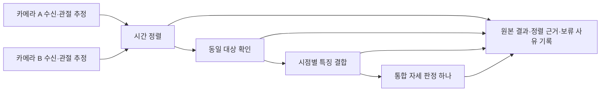

# 두 카메라 통합 자세 판정 설계

[문서 목차](../README.md) · [분야 목차](README.md) · [현재 상태](../PROJECT_STATUS.md)

[진행 현황](../PROJECT_STATUS.md) · [측정 작업실](../guides/LIVE_MEASUREMENT.md) · [결정 사항](../DECISIONS.md)

2026-10-27의 목표·대안 설계입니다. **현재는 그룹 제어·잠정 추적·수신 시각 정렬·관측 자료와 양쪽 자세 일치 판정이 구현**되어 있습니다. 관절 상호 보완·노출 동기화·삼각측량은 후속입니다. 아래 대안·완료 조건은 제안이며, 당시 미구현 설명과 현재 상태를 구분합니다.

## 목표와 현재 차이

같은 침대의 한 사람을 두 카메라로 촬영해 하나의 자세 결과를 냅니다. 격자 보기는 독립 입력을 표시하며 그룹을 설정하면 현재의 제한적 일치 판정을 사용할 수 있습니다. 이번 설계는 모델 학습 전에 통합 측정·시간 정렬·근거 기록을 연결하는 기준입니다. 단일 카메라 측정도 유지합니다.

현재는 시간 정렬·동일 대상 확인·특징 결합·자세 분류기가 모두 없습니다. ‘통합 측정’ 버튼만 추가하고 이 단계가 작동한다고 표시하지 않습니다.

## 측정 그룹

- 새 GroupSession은 두 입력 ID, 그룹 ID, 참가자 식별용 임의 ID, 설정 스냅샷을 가집니다. 한 입력을 같은 시간에 여러 그룹/독립 측정에 중복 참여시키지 않습니다.
- 각 입력의 SDK·원본 관절·좌표계·침대 영역과 측정 폴더를 유지합니다. 그룹 기록은 이 결과를 참조하며 원본을 덮어쓰지 않습니다.
- 시작 전 두 입력의 연결·첫 프레임·침대 영역과 대상 지정 상태를 확인합니다. 두 사람이 있는 상황을 후보 p0 자동 선택으로 해결하지 않습니다.
- 그룹 시작 요청 하나를 두 Worker에 전달합니다. 각 실제 시작 ACK와 첫 기록 프레임/수신 시각을 따로 남깁니다. 버튼 시각을 동시 노출 시각이라고 부르지 않습니다.
- 한쪽 시작 실패 시 시작된 쪽도 종료하고 그룹을 failed로 마칩니다. 부분 결과는 보존합니다.
- 종료 요청 하나로 두 Worker를 정리하고 양쪽 최종 결과·파일 검사를 확인합니다. 두 카메라의 종료 시각과 마지막 프레임이 같다고 가정하지 않습니다.
- 그룹 참여 입력 삭제는 그룹 전체 기록 정리 후 처리합니다. 한쪽 오류 시 통합 판정을 즉시 보류하고 기본 제안은 그룹 종료입니다. 자동 단일 카메라 전환은 하지 않습니다.

그룹 상태: preparing → starting → recording → stopping → completed/failed. 통합 분석 상태(미연결/정렬 불가/대상 불확실/판정 보류)는 이 수명주기와 별도로 저장합니다. 파일 기록 완료와 자세 판정 성공은 다릅니다.

## 시간 정렬

### 실시간 카메라

현행 received_ns는 입력마다 다른 perf_counter 기준점 이후 값입니다. 같은 프로세스/호스트에서 수집한 결과에 한해 `clock_origin_perf_counter_ns + received_ns`로 공통 단조시계 축을 구성할 수 있습니다. UTC를 정렬 기준으로 사용하지 않습니다. 실행/호스트가 다른 기록은 이 식으로 합치지 않습니다.

이 시각은 RGB 변환 뒤 반환된 **수신 완료 시각**입니다. 휴대폰과 USB 카메라의 촬영·전송·드라이버 버퍼 지연은 서로 다를 수 있습니다. 따라서 첫 단계 출력은 `receive_time_approximation`이며 촬영 시각 동기화 완료로 표시하지 않습니다. 실제 동작의 시점 오차는 별도로 측정해야 합니다.

### 저장 영상

각 영상의 상대 PTS가 0부터 시작한다고 같은 순간은 아닙니다. 동일 장면의 공통 동작/표식으로 정한 정렬 오프셋과 그 근거가 필요합니다. 두 파일을 함께 열거나 재생한 수신 시각으로 맞추지 않습니다. 공통 시각을 확인할 자료가 없으면 정렬 보류입니다.

### 초기 정렬 알고리즘 제안

- 구현/검증이 명확한 시간순 FIFO 일대일 매칭을 첫 기준선으로 둡니다. ‘최근 프레임’ 두 개를 무조건 합치지 않습니다.
- 두 큐의 선두 시각 차이가 허용 범위 안이면 한 쌍으로 소비합니다. 범위 밖이면 더 오래된 프레임은 unmatched로 기록하고 다음 후보로 진행합니다. 이는 전역 최적/최근접 매칭이라는 주장이 아닙니다.
- 같은 프레임을 여러 정렬 쌍에 재사용하지 않습니다. 재정렬·역행 시각은 오류로 처리하고 임의 보정하지 않습니다.
- 허용 시각 차이, 대기 시간, 큐 상한은 명시적 실험 설정입니다. 아직 검증된 기본 수치는 없습니다. 지연 실측 뒤 정하며 숨은 상수를 넣지 않습니다.
- 큐 초과·상대 입력 지연·그룹 종료 시 남은 프레임을 각각 별도 사유로 기록합니다. 화면 표시용 큐는 프레임을 교체하므로 정렬 입력으로 사용하지 않습니다.
- **기록 경로의 모든 처리 결과**에서 정렬용 경량 참조를 전달하고, 정렬 결과/미매칭을 모두 추적합니다. 느린 그룹 처리로 원본 기록에 영향을 주지 않도록 유한 큐와 초과 기록을 둡니다.

정렬 행에는 그룹 ID, 양쪽 측정 ID/프레임 ID, 원래 시각/시간축, 변환 시각, 오프셋 근거, 부호 있는 시각 차이, 매칭 방식과 설정 해시를 남깁니다. 단순히 matched라고 써서 동일 노출을 보증하지 않습니다.

## 동일 대상과 정보 결합

초기에는 운영자가 양쪽 영상에서 동일 참가자를 지정하고 기록합니다. 이 지정은 이후 프레임의 자동 추적 성공이나 실제 정답 자세를 보증하지 않습니다. 추적 미구현/대상 전환 불확실이면 통합 판정을 보류합니다. 여러 인물이 나올 수 있는 기존 환경 조건을 유지합니다.

| 후보 | 필요한 작업 | 주요 한계 |
|---|---|---|
| 시점별 특징 결합 후 분류 | 각 시점 관절/결측/침대 상대 특징, 공통 라벨·학습/평가 자료 | 두 시점의 오류가 함께 유입될 수 있고 미학습 조합 일반화는 미확인 |
| 카메라별 판정 후 결합 | 각 분류기·점수 보정과 충돌 처리 기준 | 현재는 규칙별 판정 일치 방식. 근거 보완·점수 보정은 후속 |
| 보정 후 3D 관절 복원/분류 | 내부/외부 보정·좌표 대응·시간 정렬·재투영 검증 | 가림/키포인트 오류·설치 변경 시 재보정 부담 |

현시점에 한 방식을 최종 선정하지 않습니다. 특징 결합을 먼저 구현 가능한 비교 기준선으로 검토하되, 정확도가 더 높다고 주장하지 않습니다. 다른 카메라의 2D 좌표·MediaPipe world 좌표는 그대로 평균하지 않습니다. 점수가 높다고 가려진 관절의 실제 위치가 맞다고 인정하지 않습니다.

초기 클래스는 바로 누움·옆으로 누움·걸터앉음을 유지합니다. 이탈/복귀는 통합 자세 분류와 별도 시계열 이벤트 모듈이며, 화면에서 사라진 것만으로 이탈 처리하지 않습니다.

## 화면

1. ‘통합 측정 그룹 만들기’에서 서로 다른 입력 두 개 선택.
2. 그룹 이름 아래 두 영상·각 침대 영역·대상 지정 상태 표시.
3. 통합 시작/종료 버튼과 양쪽의 실제 시작/종료 상태 표시.
4. 가운데 통합 결과는 하나만 표시. 분류기 미연결 시 ‘통합 판정 미연결’.
5. 정렬 방식·시각 차이·미매칭·연결 오류를 별도 표시. 한쪽 실패가 다른 쪽 화면에 가려지지 않게 함.
6. 개별 관절 결과와 그룹 결과를 함께 검토하되 계획 목표·정답·센서 결과는 예측 근거로 넣지 않음.

## 코드와 기록 경계

| 모듈(제안) | 책임 |
|---|---|
| group_session.py | 입력 예약, 그룹 시작/부분 실패 롤백/종료, ACK 수집 |
| time_alignment.py | 명시적 시간축 변환·유한 큐·FIFO 매칭/미매칭; 카메라/모델 미의존 |
| group_recording.py | 그룹 manifest·양쪽 결과 참조·정렬/실패 기록 및 무결성 검사 |
| target_association.py | 양쪽 대상 지정과 연속성 상태; 자동 동일인 보증 금지 |
| fusion.py | 대체 가능한 특징/판정/3D 결합 인터페이스; 미연결 시 명시적 보류 |
| live_web.py / HTML | 그룹 API와 두 영상/통합 상태 UI |

그룹 기록은 기존 live-0.2 결과를 참조하는 별도 draft 형식으로 설계합니다. 기존 형식을 조용히 바꾸지 않습니다. 원본/모델/설정 해시를 유지하고 정렬 설정/버전·분류기 미연결 상태를 명시합니다. 그룹 기록 저장 실패는 전체 성공으로 보고하지 않습니다.

## 구현 순서와 완료 조건

1. **그룹 수명주기·동시 조작·원본 기록 연결:** 합성 입력으로 부분 시작 실패, 입력 삭제, 종료/저장 실패와 원본 보존 확인.
2. **시간 정렬 모듈:** 서로 다른 주기·알려진 시각 차이·지연·순서 오류·큐 초과·종료 잔여를 주입해 일대일 참조/미매칭 완결성 검사.
3. **작업실 그룹 UI:** 두 입력 선택/그룹 조작·양쪽 상태와 정렬 보류를 표시. 아직 자세 결과를 생성하지 않음.
4. **실제 카메라 시간 평가:** 같은 빠른 동작/시각 표식을 양쪽에서 확인해 수신 시각 정렬의 잔여 오차·변동을 측정. 표식 판독/노출 차이도 불확실성으로 남김.
5. **대상 연결·결합 기준선·통합 분류:** 동일 자료에서 각 단일 시점과 결합 결과를 비교. 참가자/세션 분할, 혼동행렬·F1·보류율·정렬 오차·한쪽 끊김 영향을 평가.

1~3단계는 학습 전 구현 가능합니다. 4~5단계에는 실제 동시 촬영 자료와 확인된 정답이 필요합니다. 임의 임계값이나 합성 테스트를 실제 자세 성능으로 보고하지 않습니다.
